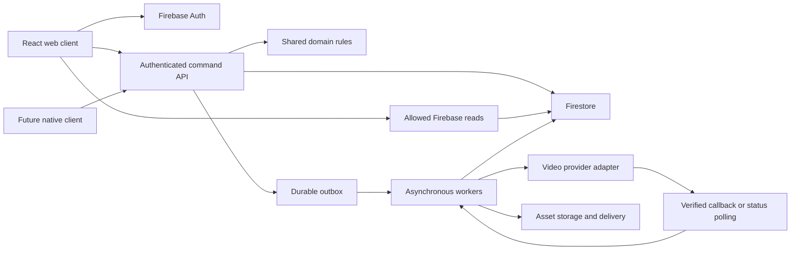

# Storybranch technical architecture

For current Story work, read [the Story system index](story-system/README.md), [target architecture](story-system/architecture.md) and [current-state review](story-system/current-state-review.md). They own the detailed StoryNode/context design and distinguish implemented services from production targets below. This document retains the broader platform design; illustrative structures are not an inventory of deployed services.

Use a TypeScript domain layer shared by a responsive React web client and future native clients. Firebase provides identity and persisted data. Vercel hosts the web application and short request handlers. Expensive media work uses durable job records and asynchronous workers.

All choices below are proposed implementation defaults except the user selected React, TypeScript, Firebase, and Vercel stack. Pin supported dependency versions when implementation begins.

Hosting moved from Netlify to Vercel on October 15, 2026 (C02 in the [decision register](10-decisions-and-open-questions.md)). Check Vercel's current function limits before relying on them.

## Application structure

The current player uses `Story` context and a shared `Page` parent for text, text/options, video, video/options, dice, reveal and comic. The portable graph is `Story.pages`; see [Story and Page model](16-story-pages.md) for current contracts and prototype format changes, and [the context architecture](story-system/architecture.md#logical-contexts-and-react-composition) for target ownership.

```text
apps/web                  React web routes and interface
packages/domain           Pure story, condition, combat, and progression rules
packages/contracts        Runtime schemas, API types, and error contracts
packages/api-client       Authenticated client commands and queries
packages/design-tokens    Colors, spacing, typography, and motion tokens
services/api              Vercel handlers and server authorization
services/workers          Generation, asset ingestion, and reconciliation
firebase                  Rules, indexes, emulator configuration, migrations
fixtures                  Small stories and deterministic provider fixtures
docs                      Product and technical specifications
```

Start with React and a Vite-based build for the interactive application. Public story and library routes need server-rendered or generated metadata responses at the same canonical URLs for link previews. Select and verify the Vercel routing implementation in the foundation milestone rather than assuming a SPA rewrite solves crawler previews.

The domain package must not depend on React, DOM APIs, Firebase SDKs, Vercel request objects, or provider SDKs. Domain functions accept serializable state and commands and return results. The API imports those functions for authoritative execution; the client may use them for previews but cannot commit trusted results.

## System flow



## Firebase responsibilities

Use Firebase Authentication for identity, Cloud Firestore for documents and transactions, and Cloud Storage for uploaded and generated media. Keep private profiles separate from public creator records. Query public story summaries rather than entire graphs for catalogue cards. Store nodes separately; never grow a story graph or playthrough log indefinitely inside a single document.

Client reads and owner draft edits can use Firebase SDKs with restrictive rules. All wallet mutations, account rewards, publication, committed gameplay, featured ownership, and trades go through the command API. Server SDK operations require their own authentication and authorization because they use IAM rather than client Security Rules. See the [Firebase security reference](https://firebase.google.com/docs/firestore/security/overview).

Use a server transaction for each contested state transition. Firestore may retry a transaction; never call a video provider, payment processor, or send a notification inside its callback. Instead commit an outbox item with the state update and let a worker perform the external action. See the [transaction reference](https://firebase.google.com/docs/firestore/manage-data/transactions).

## Vercel and worker boundaries

Vercel serves the application, public metadata pages, and short command endpoints. A generation command returns a job ID quickly. Webhooks acknowledge after recording a durable inbox event; ingestion and accounting continue independently.

Vercel functions have a bounded maximum duration that depends on the plan. Therefore provider waiting cannot rely on one long-running invocation. See [Vercel function duration](https://vercel.com/docs/functions/configuring-functions/duration). Proposed production worker infrastructure is a Firebase/Google Cloud worker with a durable managed task queue and scheduled reconciler, keeping web hosting on Vercel. Prototype polling can be simpler, but production must prove retries, leases, and recovery across process death. Verify the chosen queue's current configuration during implementation.

A leased outbox dispatcher performs bounded work, extends or relinquishes its lease, and persists the next attempt time. Duplicate delivery is expected. Dead-letter jobs become visible operational incidents. Reconciliation scans indexed due jobs, compares provider and local status, and repairs stalled work without creating a new paid request.

## Media and publication

Uploads go to private staging paths using a constrained authenticated upload flow. Validate type, byte size, duration, ownership, and safety before marking an asset ready. Generated results follow the same readiness pipeline. Save originals and delivery renditions with immutable IDs, poster images, captions, and provenance. An adaptive streaming/transcoding service can be added behind the asset interface when measured usage justifies it; do not claim it exists in the first slice.

Draft nodes reference mutable selections of immutable assets. Publication materializes a version from a fixed draft revision, validates the entire graph and assets, then atomically updates the published version pointer only after the version manifest is complete. Larger graphs may require multiple writes into an unpublished staging version. Readers cannot see that version until its manifest is marked ready and the pointer moves. Editing during publication produces a new draft revision, not a mixed snapshot.

Saved playthroughs pin story and ruleset versions. Storage retention follows reference counts or an equivalent dependency index so source deletion cannot silently break existing branches. Moderation may override availability without rewriting immutable narrative content.

## Portability to native clients

Build responsive web first and consider a PWA shell for installation and cached static assets. A later React Native client reuses domain rules, schemas, API client concepts, and design tokens. Web components and graph canvas code are not promised to be reusable in native rendering.

Define interfaces for video playback, secure auth persistence, upload selection, deep linking, share sheets, push notifications, and billing. Each client supplies its own implementation. Keep routing URLs and API contracts stable so web share links can become native deep links later. Native billing and entitlement verification need a separate design before paid native release; web checkout cannot simply be assumed valid for every native distribution channel.

## Environments and delivery

Use separate Firebase projects, storage, provider keys, and billing modes for development, staging, and production. Vercel previews must use staging or emulator-backed services, never production writes by default. Start local work with the Firebase emulator suite and a fake provider adapter.

CI should typecheck, validate schemas and fixtures, test domain rules and transactions, exercise Firestore/Storage rules, and build the web application. Version migrations and index definitions belong in source control. Deploys must preserve compatibility with existing saves and in-flight jobs; destructive schema changes require a staged migration and rollback plan.

Target a small initial bundle and lazy-load the creator graph. Pagination, bounded realtime subscriptions, poster-first loading, and conservative media prefetching matter more than speculative microservices. Tune regional placement using actual API-to-Firestore latency and transaction contention.
