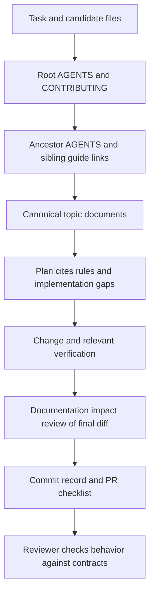

# Documentation discovery and review

Status: repository working agreement. Markdown instructions and review templates are present; automated enforcement described below is future work.

## One contract, several entry points

Keep architecture in [docs/story-system](story-system/README.md). Keep short `AGENTS.md` routing instructions near the affected code. A local sibling guide can explain that folder and link to the canonical documents without copying their rules. [STORY_COMPONENTS.md](../apps/web/src/STORY_COMPONENTS.md) is the current web entry point. Moving components into a future `story/` folder must preserve this link chain.

Before planning or editing a file, walk its ancestor directories and read their instructions, then consult the table below. Use the same process for child folders, renamed files, CSS, tests and fixtures. Agents launched at the repository root must explicitly inspect deeper instructions when selecting work there.

Codex documents instruction discovery from the project root to the session's working directory, subject to overrides and a size limit. It does not promise to load every arbitrary sibling Markdown file. That is why this repository explicitly requires the additional path-based reading step. Other tools and human contributors use the same workflow regardless of their automatic discovery behavior. [Official AGENTS.md guidance](https://learn.chatgpt.com/docs/agent-configuration/agents-md).

## Required reading by change

All paths below are repository-relative. The root instructions and [CONTRIBUTING.md](../CONTRIBUTING.md) apply everywhere. Read the union of rows for cross-cutting work.

| Affected area, including descendants | Required reading before planning |
| --- | --- |
| Any Story-related work | [Story index](story-system/README.md), [canonical terminology](story-system/terminology.md), [current contract](16-story-nodes.md), then the index's topic-specific documents |
| `apps/web/src` story/player/rendering/authoring components and styles | [local instructions](../apps/web/src/AGENTS.md), [sibling component guide](../apps/web/src/STORY_COMPONENTS.md), [StoryNode rendering](story-system/node-rendering.md), [types](story-system/node-types.md); [design system](21-design-system.md) for UI |
| `packages/contracts`, `packages/domain`, `packages/api-client` | [nodes](story-system/story-nodes.md), [architecture](story-system/architecture.md), [data/storage](story-system/data-storage.md); context and key documents for state/conditions |
| `packages/email`, account email routes and pages | [local instructions](../packages/email/AGENTS.md), [system emails](22-system-emails.md), [design system](21-design-system.md) |
| `services/api`, `services/functions`, `services/vercel`, `api` | [architecture](story-system/architecture.md), [data/storage](story-system/data-storage.md), [UserContext](story-system/user-context.md); [AI authoring](story-system/ai-authoring.md) for assistant/generation changes |
| `firebase`, migrations, persistence/seed scripts | [data/storage](story-system/data-storage.md), [keys](story-system/keys.md), [shared Firebase setup](15-shared-firebase-setup.md); affected context contracts |
| `fixtures`, `tests`, `scripts/*check*`, browser checks | The same contracts as the behavior under test, [examples](story-system/examples.md) and [current-state review](story-system/current-state-review.md) |
| Studio, graph, outline, reusable library, media tools | [nodes](story-system/story-nodes.md), [types](story-system/node-types.md), [AI authoring](story-system/ai-authoring.md), [Creator Studio](17-creator-studio.md) |
| Architecture or process docs, instructions, templates | [Story index precedence](story-system/README.md#authority-and-status), [decisions](story-system/decisions.md), this workflow and all directly affected owning documents |

A file not listed by name is not exempt. Use its responsibility and dependencies. If a new subsystem has no entry point, add a scoped `AGENTS.md` and a link from this table as part of the change. For non-Story work, read the numbered document owning that feature rather than loading every Story document.

## Enforcement levels

| Level | Status in this change | What it does and cannot do |
| --- | --- | --- |
| Root/scoped instructions and topic links | Present | Direct agents and humans to relevant contracts before planning; compliance still requires following the instructions |
| Pre-commit review agreement and Markdown PR template | Present | Require a review record and expose omissions; do not execute checks or block Git |
| Optional local pre-commit/pre-push check | Future implementation | Fast link/status/contract checks and review reminders; bypassable, never sole enforcement |
| Required CI documentation-impact check | Future implementation | Evaluate base-to-head changed paths including renames, require a review record, validate links/diagrams and run appropriate contract checks |
| CODEOWNERS and protected-branch review | Future repository administration | Require an actual designated owner review and required CI; needs real owner handles and repository permissions |

The recommended enforceable gate is CI plus protected-branch review, with local hooks only as convenience. Do not install hooks or change remote policy during documentation-only work. Current CI is [check.yml](../.github/workflows/check.yml); it runs application checks, not a documentation-reading gate. Remote branch protection has not been inspected.

## Future gate acceptance criteria

Use this as the specification when enforcement implementation is requested:

1. Maintain a versioned path-to-document map with a catch-all review for new paths. Detect changes to code, styles, fixtures, tests, contracts and the map itself, including moves and deletions.
2. Require a review record naming affected rules and concrete impact. Accept an explained no-contract-change result for internal refactors and simple fixes; do not require touching a doc on every code change.
3. Check relative links, Mermaid syntax, required type-contract sections and references to decision IDs. Run semantic contract tests where applicable. Text matching is not a substitute for those tests.
4. Require human owner review for changed authority, storage, imports, entitlements or publication policy. Choose actual maintainers when setting up ownership; this document invents no handles.
5. Re-evaluate on new commits and invalidate stale approvals according to repository policy. Document the exception process, actor, reason and follow-up; do not silently skip failed gates.
6. Demonstrate that missing review evidence blocks a test PR, a valid no-impact explanation can pass review, renamed components retain coverage, and local hook bypass does not bypass the merge gate.

No mechanism can prove a person or model understood a file merely because it was opened. Enforce traceable decisions, testable behavior and review accountability.
