# AI, creator tools and Story contracts

Status: target boundary and current integration map. Decision S10. Read [Creator Studio](../17-creator-studio.md), [Copilot](../19-copilot.md) and the affected node type contract before changing AI features.

AI helps creators produce drafts and assets. It has no independent authority to publish, route a player's run, roll dice, finish a battle, grant a key or validate a paid entitlement. The same schemas and permission checks apply to human-edited and generated content.

## Authoring flow

```mermaid
flowchart LR
  Creator[Creator brief and selected draft context] --> Request[Bounded assistance request]
  Request --> Model[Provider adapter]
  Model --> Validate[Schema and content validation]
  Validate --> Suggestion[Reviewable suggestion or generation plan]
  Suggestion --> Accept[Creator accepts changes or generation plan]
  Accept --> Draft[Revisioned private draft]
  Accept --> Generate[Authorized asset-generation jobs]
  Generate --> Assets[Validated private assets with provenance]
  Assets --> Placement[Creator-selected placement or accepted binding plan]
  Placement --> Draft
  Draft --> Publish[Normal publication validation]
  Publish --> Edition[New immutable edition]
```

Accepting a bounded generation plan may authorize automatic placement of its resulting assets into specified draft targets. It does not authorize changing unrelated pages or publishing. Revalidate draft/story/node/field identity and revision before placement; if the creator changed the target after the plan was accepted, offer conflict resolution rather than overwriting newer work silently.

## Context sent to AI

Send only the draft slice needed for the action: selected node, surrounding synopsis, declared output slots, allowed type schema, style/cast references and creator instruction. Story text, uploaded references and model output are data, not privileged instructions. Bound lengths, counts and nested structures; escape/encode untrusted content for its transport. Model output must pass runtime validation even with a structured-output provider.

Do not send authentication credentials, complete UserContext, billing records, unrelated saves or private form responses by default. A future personalized writing feature needs its own purpose, data projection and consent/retention contract. AI-generated free text cannot become executable conditions or unknown node types.

## Jobs, costs and recovery

Store owner, normalized request fingerprint, accepted draft/target revision, provider/model/config version, input asset references, job status, result asset references and failure/retry evidence. Display the scope and any estimate before submitting paid generation. Estimates, quotas and prices are deployment settings, not permanent architecture guarantees.

Jobs must be idempotent, bounded and recoverable. Persist job state before contacting a provider, reconcile uncertain submission outcomes, and apply successful results only to authorized targets. Production background execution needs durable workers/leases and deduplicated placement, not only a component-independent browser store. Retry of an unknown response keeps its key/payload; a deliberate new generation after an explicit failure/edit is a new intent.

Generated assets enter the private library, pass the same readiness/ownership checks as uploads and carry provenance. A creator can reuse them through pinned references. Finishing a job cannot rewrite a published edition or change a currently playing node. Partial failures leave completed assets available and failed jobs individually retryable. Notifications use overlays or reserved space.

## Current implementation and limits

The latest pull adds `comic` pages, a comic-script companion, cast references and panel generation. Studio assistance produces bounded suggestions that enter the ordinary draft workflow. Comic drawing is coordinated by `apps/web/src/comic-drawing.ts` outside components, so it can continue during in-app navigation and place images when its draft reopens. Reloading/closing the tab stops that placement queue; completed images remain in the asset library. This is not durable browser-independent orchestration.

Generation is currently request-driven with job records and stale-job handling. The current daily generation limit is 100 in `packages/contracts/generation.ts`, and the UI exposes remaining allowance. This is an observed alpha setting, not a commitment for future plans. Current model names/prices belong to feature/config documentation and must be checked when integrating providers.

Target safeguards such as accepted-target revision conflict checks and durable placement reconciliation require implementation and tests; their appearance here does not claim they exist. Runtime generative player outcomes remain outside scope. Battle AI, if introduced, may choose among validated legal enemy actions; it cannot decide authoritative damage or rewards outside the rules engine.

## AI development agents

Coding agents follow [the documentation workflow](../development-workflow.md) and [CONTRIBUTING](../../CONTRIBUTING.md). Plans identify the documents/rules read, the current-to-target gap and the verification needed. Generated implementation must preserve portable schemas, shared Page lifecycle and authoritative commands. A model's claim that it reviewed a file is not an independent review or a passing test.
