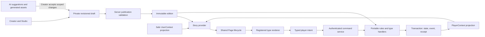
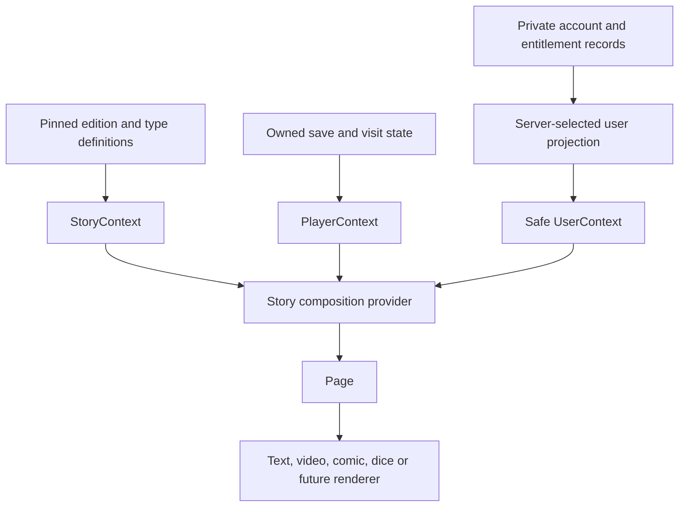

# Story system architecture

Status: target design. Read [document authority](README.md#authority-and-status) and [current gaps](current-state-review.md) before implementation. Decisions: S01, S04, S05, S07, S08, S10 in [the register](decisions.md).

## Definitions and boundaries

| Concept | Responsibility | Not stored here |
| --- | --- | --- |
| Story identity | Stable creator-owned work and catalogue identity | A player's mutable progress |
| Draft | Mutable authoring graph, revisions, layout and work in progress | Trusted gameplay outcomes |
| Edition | Immutable published graph plus pinned content, rules and type versions | Mutable creator selections |
| StoryNode | A graph placement: type/config, input bindings, entry effects and output bindings | SDK objects or another player's state |
| StoryPage | Presentation and interaction for the current node | Authority to choose a trusted route |
| StoryLeaf | Narrative endpoint and completion disposition | A dead screen without replay/return/discovery |
| StoryContext | Read-only edition, declared variables, imports/exports and type definitions | Run-local inventory or account credentials |
| PlayerContext | One run/save and its durable interaction state | The account wallet or all other runs |
| UserContext | Account identity, profile, achievements and verified entitlements | A shared mutable story save |

A node's content can be reusable, but placement and routing belong to an edition. A library revision describes content and output slots; each placement binds those slots independently. An edit to the library never mutates an existing placement snapshot, published edition or save.

## Application and authority flow

Creator draft changes and AI suggestions are untrusted inputs until validated. Published configuration is fixed but does not authorize arbitrary scripts. Renderers emit intent. The service validates identity, ownership, access, edition, run revision, input shape and allowed completion before the domain resolves outputs. Effects, costs, results and destinations are persisted with the event and receipt.

## Logical contexts and React composition

These are logical ownership boundaries; they do not require three React providers or a state-management library. The existing `Story` provider already composes story metadata, `save` and `StoryUser`. A future implementation may expose selectors or nested providers while keeping one source of truth for each field. Native clients consume the same portable projections through native adapters.

## Extension architecture

Use an explicit, versioned registry in each appropriate layer, keyed by `typeId` and `typeVersion`:

| Layer | Type registration contains |
| --- | --- |
| Contracts | Bounded config, resolved input, intent, durable state and result schemas; output slot definitions |
| Domain | Pure validation and transitions; result-to-output selection; completion and recovery semantics |
| Service | Authorization and trusted integrations such as RNG or verified ad completion; persistence orchestration |
| Web/native | Renderer inside the shared Page lifecycle; loading, focus, accessibility and error states |
| Studio | Config editor, defaults, input/output connectors, validation messages and preview fixtures |

An exhaustive compile-time mapping is sufficient initially. This is not a downloadable plugin marketplace or permission to run creator-supplied JavaScript. Do not put React renderers in the portable registry. Adding a type should add its contract/handlers/adapters and register them, not duplicate routing and save logic across screens.

## Lifecycle boundaries

Creator starts blank → saves incomplete draft → previews a valid snapshot → server publishes a new edition → player starts a separate run pinned to that edition → each node is entered, interacted with and resolved → StoryLeaf closes the run → shared completion UI offers replay, return or discovery.

Preview uses the same contracts, domain and Page hierarchy in an isolated disposable environment. It may use deterministic test randomness; it cannot award real keys, persist account rewards or simulate a verified entitlement. Child stories start their own runs and only receive explicitly allowed entry values. Returning resumes the parent's current authoritative state; it never overlays the child save onto it.

## Implementation boundaries

`packages/contracts` and `packages/domain` remain free of React, Firebase, browser and Node APIs. Services inject time, randomness and verified external evidence. UI adapters own media playback, focus and platform-specific details. Storage adapters own physical persistence, without becoming the place where gameplay rules are invented.

This design does not implement combat, billing, runtime generative storytelling, multiple player personas or multiplayer. It leaves extension points with explicit authority contracts rather than treating those future features as arbitrary JSON.
