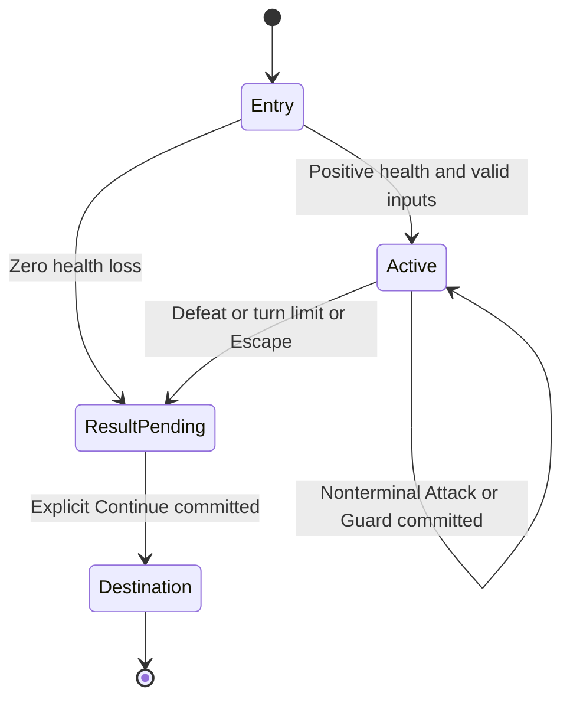

# TurnBasedBattle — S35

Status: **S35a–g portable rules, graph compilation, staged persistence, mixed traversal shared player rendering and root/replay starts implemented; public combat authoring/publication not enabled**. Established October 26, 2026. These are recommended first-version defaults, not previously user-specified combat rules. Root starts negotiate battle capability; creator publication still rejects combat; the shared renderer consumes capability-gated projections of explicitly marked editions. This document owns the initial battle rules and acceptance criteria; read [types](node-types.md), [PlayerContext](player-context.md), [StoryBranch data](branch-data.md), [storage](data-storage.md) and [rendering](node-rendering.md) alongside it.

## First version

One player fights one enemy. Attack, Guard and Escape are always available while active; Continue is available only after a terminal result. There are no paid actions, consumables, party members, equipment, critical hits, random damage, status stacks or account rewards in this version. Deterministic rules make the initial implementation and private playtests reproducible. Additional mechanics require a new versioned contract rather than hidden exceptions.

Battle uses the player's existing run-local health and stats, not a separate account character. Health damage persists in that run. A loss does not itself complete the Story; explicit Continue follows the loss StoryBranch, which can lead to recovery content or a StoryLeaf. Escape is guaranteed, costs nothing and never becomes a network-error fallback.

## Typed configuration and inputs

Planned type identifier: `battle`; configuration version `1`; combat rules identifier `battle-1`. This is a separate pinned combat rules identifier, not a reinterpretation of the existing Story ruleset. Only scene placements may use it; a battle cannot also be a StoryLeaf. Existing placement title/transcript provide its heading and accessible description.

| Configuration field | Exact first-version contract |
| --- | --- |
| `version` / `rules` | Literal `1` / `battle-1` |
| `enemy` | Exactly `{name, maxHealth, attack, defense, agility}`; trimmed name 1–80 characters; integer maxHealth 1–100, attack 1–20, defense 0–10, agility 1–20 |
| `maxTurns` | Integer 1–30; creator default 20; exhaustion resolves to loss with reason `turn-limit` |
| `inputs` | Optional object mapping `preemptive`, `attackBonus`, `defenseBonus` to distinct declared S32 input names; each mapping optional |
| Outputs | Exactly three unconditional routes, `win`, `loss`, `escape`, each using existing destination/effects/inputBindings semantics; no action costs or conditions on these required exits |

All objects reject unknown fields; finite integer bounds are enforced in portable schemas. No custom expressions, scripts, opponent AI or asset requirement. The editor supplies configuration and output bindings, never runtime state.

Inputs are resolved from the current entry's S32 snapshot before combat begins:

- `preemptive`: boolean, defaults false when no mapping is configured. True makes the player act first in every round of this encounter. False uses agility order; it does not force the enemy first.
- `attackBonus`: integer 0–10, defaults zero without a mapping; added to player attack for this encounter only.
- `defenseBonus`: integer 0–10, defaults zero without a mapping; added to player defense for this encounter only.

A configured mapping must refer to a declared required input. Every incoming route, including StoryTrunk entry defaults, must provide it with a compatible type and provable value range. S32 scalar limits alone are insufficient: publication checks the range of the actual constant, default or Dice source. A raw d20 value cannot feed a 0–10 bonus; a constant on the pass/fail route can. No clamping or coercion conceals incompatible authoring. Runtime validates again before committing entry. No mapping may read arbitrary account data, previous combat state or another run.

These bonuses are the first supported form of encounter buffs: one value per attribute, no stacking, fixed for the whole encounter, discarded on exit. General timed effects, debuffs and enemy-first overrides remain deferred.

## Rules and action order

Entry first resolves inputs and applies the existing destination entry effects under their current once-per-run policy. Then snapshot the run's resulting health and stats. Enemy health starts at maxHealth. Player maximum health remains 100; no healing occurs merely from entering or revisiting battle.

- Player attack = `2 + floor(strength / 2) + attackBonus`.
- Player defense = `floor(resolve / 4) + defenseBonus`.
- Attack damage = `max(1, attackerAttack - defenderDefense)`.
- Normal initiative: player first when player agility is greater than or equal to enemy agility; otherwise enemy first. Preemptive true overrides this. Order stays fixed for the encounter.
- The enemy always attacks. It has no randomness, resource pool or selectable target.

One accepted Attack or Guard command resolves one complete round atomically, then increments `turns` once. The player submits its action before resolution even when the enemy has initiative. Attack deals damage in initiative order. An actor reduced to zero cannot act later in the same round. Guard deals no player damage and halves the enemy's post-defense damage, rounded up; guarding is effective for that entire round regardless of initiative and expires afterward. Health is clamped at zero. Because damage is sequential and there is no reflection or simultaneous damage, both actors cannot be defeated in the same valid round; reject impossible stored state rather than selecting an arbitrary winner.

After each attack, stop immediately on defeat: enemy zero means `win/defeat`; player zero means `loss/defeat`. If both remain alive after the round and turns reaches maxTurns, persist `loss/turn-limit` without extra damage. Defeat takes precedence over the turn limit on the final round. A zero-health player on entry immediately gets `loss/zero-health`, turns 0, with no enemy attack; Continue remains usable at zero health.

Escape immediately persists `escape/escaped`, does not run an enemy action, does not increment turns and retains current health. The active run can remain paused indefinitely; elapsed wall-clock time is not a combat turn. Leaving the browser, going offline or opening a child Story does not secretly resolve a round or escape.

Example: strength 8, resolve 8, agility 5, bonuses zero; enemy health 10, attack 7, defense 1, agility 4. Player attack 6 and defense 2. Attack deals 5, then enemy deals 5. The second Attack defeats the enemy before retaliation: win at turns 2, player health 95 from a starting 100. Guard on round one instead deals zero and receives ceil(5/2) = 3 damage. A maxTurns of 1 produces loss/turn-limit after that round.

## Durable state and commands

Store one optional version-1 battle interaction in the owned save. Its identity is bound to run ID, Story ID, pinned edition, StoryNode ID and entry revision; encode those fields canonically or use a server-derived ID with collision-free semantics. Never use node ID alone. Entry revision is stable while battle actions advance run revision. Loops create fresh encounters and fresh identities, but retain run health and existing once-only effect markers.

State contains battle identity and entry revision, pinned config version/rules, resolved initiative and derived player attack/defense, enemy health, turns (0–30), phase (`active` or `result-pending`) and terminal result when present. `Save.health` is the sole mutable source of player health; do not maintain a conflicting second health value. Preserve the entry's `nodeInputs` throughout combat. Bound state to 8 KiB serialized UTF-8; no action-history array. Events use the existing paginated log. Reject a missing/corrupt interaction on an already-entered battle instead of silently resetting it; offer retry/support and leave navigation.

Planned command: `POST /playthroughs/{runId}/battle-actions`, with existing authentication, player-contract negotiation, idempotency envelope and expected run revision. Payload contains only `battleId`, `expectedTurn` (integer 0–30), and `action` (`attack`, `guard`, `escape`, `continue`). Strict schemas reject supplied HP, damage, buffs, result, destination or reward fields. This is an extension of the shared command service, not an independent player runtime.

Authorize ownership and edition support; check exact receipt replay before current revision/phase checks. New commands must match the current battle identity, revision, turn and phase. Attack/Guard/Escape require active; Continue requires result-pending. Persist health, interaction, run revision, event and receipt atomically. Two devices using the same revision cannot both advance. Same-key/same-payload retries replay the existing response; changed payload conflicts. After receipt expiry, monotonic revision and visit checks still prevent repeating the original action. No random sampling is needed for battle-1.

Continue selects only the stored outcome. Resolve its destination input bindings from the terminal result, apply existing route effects and destination entry effects, and clear/replace the interaction in the same transaction. If destination entry fails, leave the pending result and all effects untouched. Continue cannot rerun combat or grant an effect twice. A lost response retries its exact key/payload; stale responses reconcile without replaying intent against a new turn.

## Results, routing and reward ownership

Terminal result is exactly version 1, outcome (`win`, `loss`, `escape`), reason (`defeat`, `turn-limit`, `zero-health`, `escaped`), turns (0–30), playerHealth (0–100) and enemyHealth (0–100). Enforce outcome/reason/health consistency, including maxHealth from config. It stays pending until Continue; it is not overwritten by rendering or reload.

Planned S32 source extension: `{kind: "battle", field}` where field is `won` (boolean derived from outcome), `turns`, `playerHealth` or `enemyHealth` (integers). Legal only on that battle's three terminal routes and resolved only on Continue from that visit's stored result. No generic `lastBattle` input lookup. Unselected routes do not bind or grant effects. Existing constant/Dice sources keep their behavior.

All three outcomes must reach safe StoryLeaves through the effective graph. A missing/unsafe required route suppresses the whole battle and propagates upstream with creator diagnostics; never hide Escape or turn a loss into a win to compensate. Required routes cannot depend on inventory, health, key or input conditions, including at zero health. Existing graph validation must also prove a usable continuation downstream under its conservative policy.

There is no automatic loot or XP on a terminal attack. Authored existing run-local route effects apply on Continue under existing semantics and can repeat on legitimate revisits; show this to creators. Permanent keys/achievements use existing StoryLeaf claim policies. No battle action grants paid, subscriber, account or cross-Story rights. General once-per-encounter rewards and item spending are separate future contracts.

## Rendering, disclosure and isolated preview

The battle child renderer lives inside `Story` and shared `StoryNode`. The wrapper dispatches actions, controls busy/offline/reconciliation states, and owns Continue. Show enemy name/current/max health, player current/max health, turn/maxTurns, initiative, available actions and the current authoritative action summary/result. Project only these fields plus battle identity/version and current command guards; do not ship routes, conditions, full configuration, raw inputs, receipts or unselected outcomes. Displayed facts are intentionally inspectable in developer tools.

Reserve a stable battle/status area. Animations are cosmetic, skippable and reduced-motion aware; they never authorize damage or block a committed Continue. Keyboard controls, labeled health values and a concise live announcement accompany every accepted round. Reload shows the committed state without replaying attacks. Unknown request outcomes retain that view with the shared recovery controls. Infrastructure failure never selects loss or escape.

Studio must configure all routes and show range errors, simulate the same pure rules and use the same wrapper. Before exposing battle in Studio, extend S34's versioned replay schema for battle actions and HP/outcome assertions. Existing S34 records remain valid and unchanged; do not disguise battle turns as ordinary `continue` steps. Preview remains disposable with no real player mutations or account grants.

## Delivery slices and release gates

1. Portable contracts/domain: strict config, consumer input ranges, battle state/result/intent schemas, pure rounds, all-output validation and battle result bindings. Keep authoring/publication disabled until the end-to-end path is ready.
2. Authority and persistence: transaction integration, projection, version/capability handling, exact receipts, concurrency, reload and Continue. Old editions/saves stay untouched; optional battle state is absent on existing saves. No new collection, direct Firestore permission or backfill is planned. Retain implementations of issued combat rules for pinned saves.
3. Shared rendering and Studio: battle controls, editor diagnostics, repeatable preview support, accessibility and browser verification. Enable publication only after all gates pass. Define and test client capability negotiation so an unsupported client is rejected before starting/advancing into an encounter and receives an upgrade/recovery message, never a fallback renderer. Exact wire negotiation must be documented with the API slice.

Required evidence before release:

| Layer | Acceptance cases |
| --- | --- |
| Portable | Every bound and unknown field; constants/Dice input range analysis on every edge; agility ties/preemptive; Attack/Guard in both orders; zero health; final-turn defeat precedence; Escape; fresh revisit; unsafe win/loss/escape suppression; result bindings on Continue only |
| Service | Forged stats/results/destinations; wrong owner/visit/turn/revision; duplicate and competing commands; failure after commit then same-key retry; receipt expiry; reload after each phase; atomic Continue/reward effects; pinned edition edits; isolated child runs; no private graph/input leakage |
| Preview | Same outcomes as portable rules; saved battle replay/reload; changed draft assertion failures; old S34 replay compatibility; no published test metadata or real grants |
| Browser | Shared wrapper at desktop/mobile and both themes; keyboard, reduced motion, readable HP; offline/unknown-result retry; stale tab; terminal result surviving reload; explicit Continue to every outcome; stable layout; unsupported-client recovery |

The acceptance matrix above is a release requirement, not a claim of complete implementation. S35a verification below covers only the standalone portable foundation. Combat balance beyond the example, physical device coverage and hosted rollout remain verification work. Party combat, skills, timed buffs, randomness, inventory consumption and reward design must be separately versioned before expansion.

## S35a implementation boundary

The first implementation slice adds standalone portable battle config/state/result/intent schemas, entry-input compatibility checks and deterministic round resolution. It does not register `battle` in StoryNode schemas, change Save, expose an endpoint or enable publication. The engine returns a proposed state/health update (or a pending result on Continue); only the later service transaction may persist it, route and consume it. Full graph suppression, result-binding registration, projections and renderer/replay integration remain required follow-up work. Existing editions and saves need no migration for this isolated slice.

### Portable entry points and trust boundary

`packages/contracts/battle.ts` validates battle-1 configuration, identity, bounded state/result and intent. Identity encodes the run, Story, edition, StoryNode and entry revision as a canonical JSON tuple; the strict scalar shape remains below the 8 KiB state bound. `packages/domain/battle.ts` provides `validateBattleEntry` for each incoming edge/default, `resolveBattleInputs`, `startBattle`, `actBattle` and allowlisted `battleResultValue`.

The caller must supply the server-loaded pinned config and owned state. `startBattle` receives health/stats after destination entry effects and resolved values from the correct entry snapshot; it does not apply effects itself. `actBattle` validates identity/phase, expected turn and revision, then returns a fresh update proposal or a validated pending result on Continue. Continue does not advance a save revision, clear the interaction or choose a destination here: the later atomic routing transaction must do all of those together. Input-range helpers are not yet wired into publication, and result scalar extraction does not register a new binding source. No standalone helper substitutes for authorization or receipt replay.

### S35a local verification — October 26, 2026

`pnpm check` passed: TypeScript, 162 tests (including 17 battle tests and the portable dependency-boundary check), and production build. Battle checks exercise both initiative orders, ties/preemptive, bounded bonuses, damage/Guard, final-turn precedence, free Escape, zero-health entry, 30-round exhaustion, strict schema rejection, malformed state, revision/turn/visit guards, deterministic reload and fresh revisit identity, input ranges and the continued rejection of battle by playable Story schemas. No service/renderer is integrated, so emulator/browser checks were not rerun; persistence, graph suppression and end-to-end acceptance remain unverified. Existing build chunk-size warnings remain. Self-review only; independent review pending.

## S35b terminal routing boundary

The next portable slice adds exactly three strict battle output routes and battle-only scalar bindings. `validateBattleOutputs` checks them against an existing validated effective Story, including required destination inputs; a missing/unsafe destination rejects the entire routing plan. It inherits conservative publication restrictions on inventory effects. `continueBattle` requires the engine's validated pending Continue, selects only its persisted outcome and returns the destination, route effects and next-entry input snapshot without mutating the save or applying effects.

This validates standalone battle output plans against the current supported graph; it does not yet register battle placements in the graph compiler. Destinations must be present in the validated effective Story; disconnected draft content is not silently promoted. Mixed battle graph compilation, incoming battle edges, atomic service consumption, renderer and publication enablement remain follow-up work. Real Story schemas still reject both battle placements and battle sources on ordinary routes.

S35b adds Story ID to the canonical battle identity and bounds its serialized command ID to 400 characters, enough for all five tuple members at their maximum lengths. Continue verifies both Story and edition identity against the routing graph. This changes only the unissued standalone battle schema: no existing persisted run/edition has battle state, so no backfill or compatibility adapter is required. The exported shared command-scope schema keeps revision guards consistent between action and routing helpers.

### S35b local verification — October 26, 2026

`pnpm check` passed: TypeScript, 176 tests (14 new battle-routing cases plus the 17 battle-engine cases), and production build. Tests cover win/loss/escape, pending-only Continue, result/default/constant binding, whole-plan rejection of unsafe required destinations, disconnected targets, missing required inputs, strict output shapes, conservative inventory-effect rejection, stale/foreign identity guards and no input mutation. Maximum-length scoped identity and rejection of battle sources by current real Story schemas are checked. No service/UI integration is present, so emulator/browser checks were not rerun. Mixed battle graphs and authoritative persistence remain unverified. Existing bundle warnings remain; review was self-review.

## S35c staged mixed-graph compilation

A separate strict staged Story schema accepts normal placements plus battle scenes with `battle` configuration and exactly three `outputs`. Battle scenes reuse id/title/transcript/inputs/entryEffects; no ordinary choices, leaf role, media or reusable-library fields are accepted yet. Maximum graph size remains 80 placements. Live Story/draft/API schemas remain unchanged and reject combat.

The staged compiler uses the existing conservative publication algorithm with all-outcomes-required battle nodes and per-edge battle input checks. An internal proof view expresses battle outputs as typed routes; battle result sources are replaced only in that proof with conservative upper-bound scalar witnesses. `won` is constant per output; turns ranges to maxTurns, playerHealth to 100 and enemyHealth to maxHealth (zero on win). This proves types/ranges, never a real combat result. The returned graph restores original battle configs/bindings; proof nodes and values cannot become a playable edition.

Each incoming edge, including Dice alternatives and battle-to-battle outputs, validates mapped required inputs and bonus bounds. Entry battle defaults must also pass. Any unsafe required outcome removes its battle and propagates upstream; optional incoming choices can be hidden while a safe fallback remains. Disconnected content stays in the draft. Existing conservative inventory-effect, condition and graph checks are retained. Runtime commands/Continue integration and player capability gating remain subsequent work; this compiler cannot enable publication by itself.

### S35c local verification — October 26, 2026

`pnpm check` passed: TypeScript, 189 unit tests (including 13 mixed-graph cases), and production build. All 58 emulator integration regression tests passed after the shared compiler extension. Graph tests cover preservation/idempotence, live-publication rejection, each required output, upstream battle/Dice suppression, entry defaults, per-edge constants/Dice ranges, battle-to-battle result bounds, preemptive booleans, cycles, inventory-effect safety, strict schemas and ordinary-graph parity. Markdown links and whitespace were checked. No battle UI or authoritative endpoint exists yet; browser/device and hosted battle acceptance were not run. Existing bundle warnings remain. Self-review only.

## S35d authoritative battle command boundary

Add authenticated GET `/playthroughs/{id}/battle` and POST `/playthroughs/{id}/battle-actions`. Both require the existing player contract and `X-Story-Battle: battle-v1`. The edition manifest must explicitly carry `battleContract: battle-v1`; current creator publication cannot emit this marker. Existing clients and ordinary edition loading reject marked editions with an upgrade message. There is no public battle start/entry path in this slice; emulator fixtures create server-owned runs for verification. Incoming ordinary choices, full player projection/media integration and renderer enablement remain gated.

The action envelope uses the existing idempotency key/expectedRevision format plus the S35 intent. Owned save, pinned marked edition, encounter identity, phase and revision are rechecked transactionally. Every accepted action atomically commits health/interaction, revision, log event and receipt. Continue resolves the selected result bindings, applies route and once-only entry effects, initializes a following battle or completes a StoryLeaf, and prepares existing achievement/progress claims before any transaction writes. No read-time recompilation of issued editions. GET returns an allowlisted battle reload view or the resulting ordinary StoryNode projection, not full graphs/config/inputs. No ordinary player client consumes this response yet.

### S35d local verification — October 26, 2026

TypeScript, 192 unit tests and the production build passed. All 61 demo-emulator integration tests passed. New coverage includes chained battle entry/effects/result bindings, zero-health loss, unchanged pending state on failed input resolution, owned reload disclosure, capability rejection, explicit terminal Continue, exact retries, changed-payload conflict, competing commands, stale retry after receipt deletion, forged outcomes, once-only completion counting and transaction rollback without receipts/events/progress writes. Optional projected fields are serialized to the exact JSON response before receipt persistence. Existing bundle-size warnings remain. Markdown links and whitespace passed. No browser/hosted battle acceptance was run: public entry, media integration, renderer and Studio remain disabled follow-ups. Self-review only; independent review pending.

## S35e mixed-Story traversal boundary

Reuse the ordinary portable start/choice engine with structurally compatible staged graphs; do not convert battle placements into fake Text nodes. A staged start initializes the entry encounter after inputs and once-only entry effects. An ordinary choice resolves conditions, costs and selected route with existing semantics, then initializes a battle only on committed destination entry. Dice Roll stays on Dice; Next enters combat. Battle actions remain exclusive to the battle command endpoint, including pending-result Continue. Revisits create a fresh identity while retaining health and once-only effect markers.

For existing owned runs in marked editions, `/playthroughs/{id}/choices` uses the capability-gated staged transaction. It preserves current account-key checks, trusted Dice sampling across transaction retries, exact receipts, log item changes and completion preparation. Ordinary editions continue through their existing path. This is traversal infrastructure for the shared player; public starts, full media/player projection, renderer and publication remain follow-up gates. No client or creator can issue the edition marker.

### S35e local verification — October 27, 2026

TypeScript, 198 unit tests and production build passed. All 63 local demo-emulator integration tests passed. New tests cover ordinary-choice entry order and scalar inputs, separate Dice Roll/Next, first-node defaults, isolated parent state, fresh revisits with once-only effects, failed entry without consuming costs, account gates, malformed intent, exact retries, returning to ordinary content, stale encounter rejection and concurrent Next commands. An emulator failure exposed guard ordering: revision is now checked before current-location eligibility so the losing request receives stale-progress recovery. Existing clients avoid the staged dispatch reads. Markdown links and whitespace passed. Browser/device/hosted checks were not run because this slice has no renderer or public battle start; those release gates remain open. Existing build bundle warnings remain. Self-review only; independent review pending.

## S35f shared-player rendering boundary

Existing owned runs in marked editions can reload through the normal run GET when the battle capability is supplied. Battle and ordinary choice responses provide the full shared player view (explicit User projection, inventory, media, result and community-offer fields), with a typed `storyNode.battle` presentation. The earlier staged top-level battle projection remains an additive compatibility alias for existing staged action/reload consumers. Ordinary clients without capability remain rejected for marked editions. Public starts/publication and Studio remain gated.

Battle presentation is a child of shared StoryNode inside Story context. The wrapper owns action dispatch and duplicate suppression; the existing PlayerSession owns uncertain retries and stale reconciliation. Active controls are Attack, Guard and Escape; only explicit Continue routes after a terminal result. Reserved health/status/control space avoids layout shifts; native labeled health meters and a polite status announcement support keyboard and reduced-motion use without combat animation. Reload never replays an action. Browser checks must use emulator-owned seeded runs and the real shared player, not a standalone battle demo.

Older staged receipts lacking a full `storyNode`/`user` view return stale-progress recovery, never an incomplete success or reexecuted action. Their stored records remain untouched. Current full-view receipts replay exactly. Community side-Story offers are suppressed for marked editions until child-start integration supports them; ordinary editions retain their offers. Public root/replay starts and Studio/publication are still release gates.

### S35f local verification — October 27, 2026

TypeScript, 200 unit tests, production build and all 65 demo-emulator integration tests passed. New checks validate projected battle state, missing/corrupt views, capability headers, normal run GET, old partial-receipt reconciliation without duplicate events, full account/inventory context and video media after Continue. `pnpm test:battle` passed through the real local player at 1440px/light and 390px/dark with reduced motion: keyboard action, offline controls, committed-but-lost response with exact retry, stale second-tab reconciliation, pending result reload and explicit Continue for win/loss/escape. Before/after bounding boxes verify stable battle-result height; desktop/mobile screenshots were inspected. Browser fixtures are guarded to demo emulators and create separate runs. No hosted deployment, physical-device acceptance, public start or Studio verification was performed. Existing bundle warnings remain. Markdown links and whitespace passed. Self-review only; independent review pending.

## S35g root start and replay boundary

Capability-aware root starts and import-consent reads may load explicitly marked battle-v1 editions. Ordinary creator publication still rejects battle; child starts and community offers remain gated. The player loader validates stored shape and identity without recompiling or modifying immutable editions. Root visibility, invitation entry, same-creator export permission, explicit consent and selected completed-run evidence retain their existing checks.

A new run snapshots progress/imports and initializes its first battle after normal entry effects, before the atomic save/event/receipt commit. Replay creates a separate run; it cannot inherit an encounter or mutate the completed run. Retries reuse the committed run and snapshots. Unsupported clients fail before writes (including receipt projection). Studio publication and child-entry verification remain separate release gates.

### S35g local verification — October 27, 2026

TypeScript, 200 unit tests, production build and all 69 demo-emulator integration tests passed. Added checks cover root battle initialization, isolated replay, receipt identity/conflicts, unsupported clients, hidden/invitation entry, invalid-entry rollback, consented persistent imports and selected completed battle runs without source-value disclosure. Browser checks passed at 1440px/light and 390px/dark with reduced motion, using real title-screen starts and post-completion replay for win/loss/escape, plus existing keyboard/offline/retry/stale/reload checks. Replay preserves completed runs and starts a fresh encounter. Desktop/mobile result screenshots were inspected. Test fixtures include complete catalogue metadata so API verification data can coexist with discovery/browser flows. Local Markdown targets and whitespace were checked. No hosted deployment, physical-device acceptance, child-entry or Studio/publication verification is claimed. Existing build chunk warnings remain. Self-review; independent review pending.
