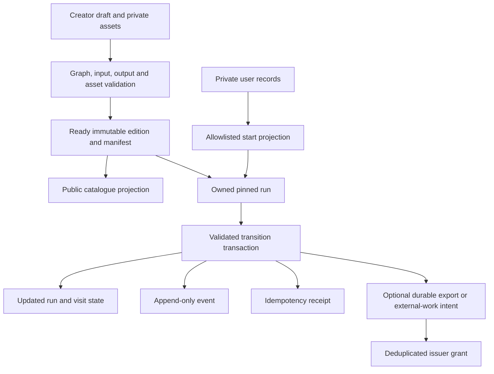
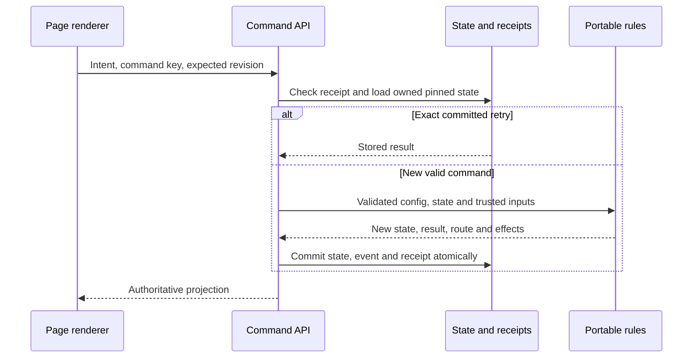

# Story data, storage and command contracts

Status: target persistence design with an explicit current-path map. Decisions S04–S10. Read the context documents and [keys](keys.md) before altering state. Examples are logical contracts, not a migration or a claim that future collections exist.

## Data ownership and storage

| Record | Current location / status | Target ownership and lifecycle |
| --- | --- | --- |
| Private account/profile | `users/{uid}` | Account service; allowlisted profile edits; no story-author writes |
| Private draft | `users/{uid}/drafts/{storyId}` | Creator through revision-checked commands; incomplete graph allowed, including future empty drafts |
| Published edition | `stories/{storyId}/versions/{versionId}` and `pages/{pageId}` | Server materializes immutable, validated graph and asset/type/rules references |
| Catalogue projection | `catalogue/{storyId}` | Safe public metadata; no private drafts, saves, answers or entitlement records |
| Reusable content | `pageLibrary/{pageId}/revisions/{revision}` | Immutable content revisions; sharing explicit; placement bindings remain in stories |
| Run/save | `users/{uid}/playthroughs/{runId}` | Server-owned PlayerContext with bounded current state; owner reads through permitted APIs |
| Run events | `users/{uid}/playthroughs/{runId}/events/{eventId}` | Append-only audit/progress facts; paginated, not a forever-growing array in a save |
| Command receipt | `users/{uid}/receipts/{hash}` | Request fingerprint, actor/scope/result/expiry; existing helper sets a 30-day expiry timestamp |
| Asset record and media file | `users/{uid}/clips/{assetId}` in Firestore and Storage | Private creator asset until explicitly published/shared; immutable reference for issued editions |
| AI jobs / quotas / history | `generationJobs/{id}`, `generationQuotas/{id}`, `users/{uid}/copilot/{threadId}` | Bounded owner-visible status; provider credentials remain server-side |
| Visits, battle state, private form responses | Deferred associated records under owned runs, or equivalent indexed design | Isolate large/sensitive type state; current visit projects only permitted data |
| Key definitions, grants, export/completion receipts | Deferred registry and user-owned grant records | Issuer-controlled definitions, unique claims and provenance; no client grants |
| Durable inbox/outbox for external work | Production target; not a guarantee of current generation durability | Deduplicated events, leases, retries and reconciliation |

Physical future collection names are intentionally not finalized. Indexes, access rules, size limits and query patterns must be designed with the feature. The old illustrative `draftNodes`/`nodes` paths in [docs/05](../05-data-and-api-contracts.md) are not today's schema and should not be reintroduced just because the conceptual name is StoryNode.

## Authoritative command sequence

The browser sends actor intent, idempotency key and expected run revision; actor identity comes from verified authentication. For future visit-aware types, include the expected visit/action scope as well. The server:

1. Validates bounded request syntax and rejects unknown fields. Authenticates the actor and authorizes the resource and relevant live capabilities.
2. Checks the receipt for this actor/command scope/key. An exact request fingerprint replays the committed response; a different request using the same key is a conflict. Recheck access before returning private data.
3. Loads the pinned edition, save and current type state. Validates expected revision, visit, status, input bindings, allowed action, conditions and costs.
4. Resolves the action through portable rules using trusted time/randomness/external evidence. No provider request, notification or paid side effect runs inside a retryable transaction callback. Any randomness needed by a retried callback is sampled once for that command execution and reused.
5. Atomically writes run/interaction state, effects/costs, event, receipt and any required durable outbox/claim reservation. A node output and its destination's entry effects are part of that state transition.
6. Returns a safe projection of the committed result. The UI transitions only after authority is established; preloading a likely destination never commits it.

Dice Roll persists pending result without routing; Next is a separate key/revision command consuming it. Battle turns follow the same revision rules. A network timeout retries the same key and exact payload. A rejected stale action refreshes state; it must not be transformed into a newly authorized choice automatically.

Command receipts are finite-lived. Their TTL is not sufficient for permanent reward deduplication; long-lived claims and state/revision checks provide that protection. Do not promise indefinite replay of a response after its receipt expires. Unknown external job outcomes must reconcile against their durable provider/job identity instead of issuing a fresh paid request.

## Publication and versioning

Draft and published schemas are separate validation stages. A blank/incomplete draft is valid authoring state but invalid publication. Publication validates all node types, required input mappings, routes, termination policies, conditions/effects, import/export permissions, content revisions and asset ownership/readiness before exposing the edition pointer.

Small editions can commit atomically. Larger staged publication must keep all parts hidden until a complete manifest is ready. Neither partially staged content nor a concurrent draft edit can leak into the published snapshot. Publishing the same source revision is idempotent. Existing code bounds draft graphs to 80 pages; target scalability must be measured and versioned, not achieved by removing bounds.

Save identity pins story edition, schema/rules versions and type semantics. Content changes publish a new edition. A migration must explicitly define source/target versions, run compatibility, pending interaction handling, data preservation, rollback and verification. Never edit immutable historical editions, repoint all saves or delete user data as a shortcut. Unsupported old formats need an explicit recovery path, not an implicit renderer fallback.

## Privacy, retention and operational boundaries

Use separate public projections for catalogue, shared pages and creator display. Authorization must apply to the whole underlying private record, not imagined per-field secrecy on a publicly readable document. Server SDK access still needs explicit authorization. Cross-story facts are served through import policy, not arbitrary save queries.

Keep current state bounded and histories paginated. Retain media referenced by issued editions, saves or public shared revisions; account/asset deletion must use a documented retention and access policy. Forms require response-specific retention/deletion decisions before launch. Narrative event integrity does not remove privacy obligations; sensitive data should not be copied into every event.

Generation workers and entitlement providers require durable jobs/inbox/outbox, signed evidence where applicable, deduplication and reconciliation. Today's browser comic queue and request-based generation are limited implementations; see [AI authoring](ai-authoring.md). This document creates no collections, indexes, migrations or external resources.
