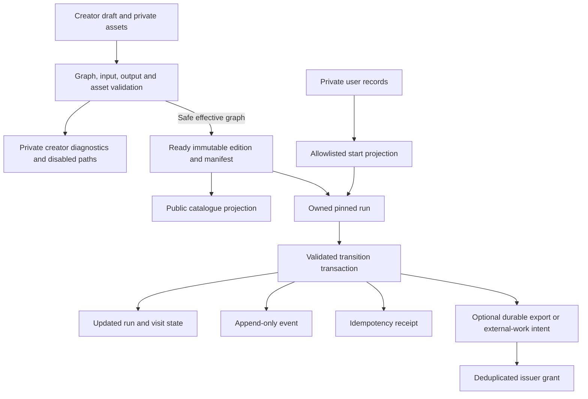
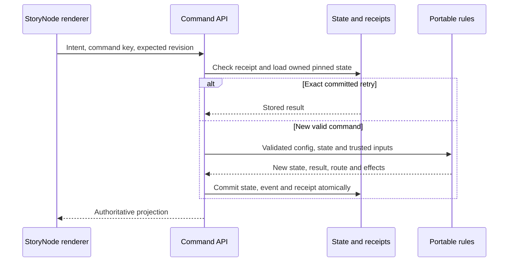

# Story data, storage and command contracts

Status: target persistence design with an explicit current-path map. Decisions S04–S10. Read the context documents and [keys](keys.md) before altering state. Examples are logical contracts, not a migration or a claim that future collections exist.

## Data ownership and storage

| Record | Current location / status | Target ownership and lifecycle |
| --- | --- | --- |
| Private account/profile | `users/{uid}` | Account service; allowlisted profile edits; no story-author writes |
| Private draft | `users/{uid}/drafts/{storyId}` | Creator through revision-checked commands; target blank draft contains one StoryTrunk and no playable placements; incomplete graph allowed |
| Published edition | `stories/{storyId}/versions/{versionId}` and `storyNodes/{storyNodeId}` | Server materializes immutable, validated graph and asset/type/rules references |
| Catalogue projection | `catalogue/{storyId}` | Safe public metadata; no private drafts, saves, answers or entitlement records |
| Reusable content | `storyNodeLibrary/{storyNodeId}/revisions/{revision}` | Immutable content revisions; sharing explicit; placement bindings remain in stories |
| Run/save | `users/{uid}/playthroughs/{runId}` | Server-owned PlayerContext with bounded current state; owner reads through permitted APIs |
| Run events | `users/{uid}/playthroughs/{runId}/events/{eventId}` | Append-only audit/progress facts; paginated, not a forever-growing array in a save |
| Command receipt | `users/{uid}/receipts/{hash}` | Request fingerprint, actor/scope/result/expiry; existing helper sets a 30-day expiry timestamp |
| Asset record and media file | `users/{uid}/clips/{assetId}` in Firestore and Storage | Private creator asset until explicitly published/shared; immutable reference for issued editions |
| AI jobs / quotas / history | `generationJobs/{id}`, `generationQuotas/{id}`, `users/{uid}/copilot/{threadId}` | Bounded owner-visible status; provider credentials remain server-side |
| Visits, battle state, private form responses | Deferred associated records under owned runs, or equivalent indexed design | Isolate large/sensitive type state; current visit projects only permitted data |
| Local completion receipt | Optional `completion` inside the run, mirrored in its completion event | Versioned, bounded, server-owned, no TTL; atomic local reward grants, retained for the run's lifetime |
| Approved account achievement definitions | `achievementDefinitions/{hash(story, edition, leaf)}` | Creator submission and audited admin review; live approval scoped to an immutable published ending |
| Account achievement claims | `users/{uid}/achievementClaims/{hash(story, leaf)}` | Server-only durable claim with definition revision, source run/edition and display snapshot; no TTL, shared across editions of the same ending |
| Other account rights and export receipts | Deferred registry and user-owned grant records | Issuer-controlled definitions, unique claims and provenance; no client grants |
| Invitation entry policy and codes | `stories/{storyId}.entryPolicy`, `stories/{storyId}/invitations/{sha256(code)}` | Creator-only revisioned policy; bounded capacity/deadline, digest-only codes; no client reads/writes. Create-command receipts temporarily retain the returned code for retry |
| Permanent invitation entry keys | `users/{uid}/storyEntryKeys/{storyId}` | One durable grant per account/Story with issuer, source invitation and time; atomically consumes one code slot; no TTL or grant revocation in S18 |
| Player + Story progress | `users/{uid}/storyProgress/{storyId}` with `keys/{keyId}` and `completions/{runId}` subcollections | Private completion counter, permanent grants with pinned source definition, durable no-TTL deduplication; atomic with run/event/achievement writes. No backfill or client access |
| Durable inbox/outbox for external work | Production target; not a guarantee of current generation durability | Deduplicated events, leases, retries and reconciliation |

Physical future collection names are intentionally not finalized. Indexes, access rules, size limits and query patterns must be designed with the feature. The old illustrative `draftNodes`/`nodes` paths in [docs/05](../05-data-and-api-contracts.md) are not today's schema and should not be reintroduced just because the conceptual name is StoryNode.

The table uses canonical names for new records. Read [naming compatibility](naming-compatibility.md) for existing editions, saves, drafts, reusable revisions and API clients. Legacy immutable records remain in place; normal future mutations write canonical fields.

Use [the terminology mapping](terminology.md#mapping-to-the-current-implementation): `StoryNode`/`storyNodeId` currently represent StoryNode placements, `kind: "ending"` represents StoryLeaf behavior, and outcome routes represent StoryBranches. StoryTrunk is a typed configuration projection over existing root metadata; optional `trunkContext` in the edition pins starting keys. Absence means no starting keys, preserving older editions. Existing `branches/{branchId}` community links identify separately authored side Stories; they are not storage records for every in-story StoryBranch. This distinction preserves the separate-context boundary.

Target publication stores the unique StoryTrunk's metadata/context definitions and a validated effective playable graph. Keep unfinished StoryBranches and their diagnostic reasons in the private draft/review record; exclude disabled routes, their options and resulting unreachable placements from player projections. Apply the [upstream validation rules](story-nodes.md#storyleaves-and-termination) before materializing an edition. Server commands accept only enabled routes and validate current conditions. Repairing a branch publishes a new edition; it never mutates an issued graph or redirects an existing pinned save. New publication now compiles this safe subset conservatively; see the implementation policy in StoryNodes. Private drafts and existing editions are preserved.

## Authoritative command sequence

S31 saved playtest setups are optional `playtestScenarios` metadata on private drafts, bounded and validated by the existing draft command schema. They share draft ownership, revision guards, idempotency receipts and the request-size limit. Stale local references are retained for creator diagnostics; only preview loading requires current declarations. Publication selects `draft.story`, so saved setups never enter an edition or player projection. No collection, migration or real-run command field is added. See [Studio scenarios](../17-creator-studio.md#stat-and-inventory-preview-scenarios).

The browser sends actor intent, idempotency key and expected run revision; actor identity comes from verified authentication. For future visit-aware types, include the expected visit/action scope as well. The server:

1. Validates bounded request syntax and rejects unknown fields. Authenticates the actor and authorizes the resource and relevant live capabilities.
2. Checks the receipt for this actor/command scope/key. An exact request fingerprint replays the committed response; a different request using the same key is a conflict. Recheck access before returning private data.
3. Loads the pinned edition, save and current type state. Validates expected revision, visit, status, input bindings, allowed action, conditions and costs.
4. Resolves the action through portable rules using trusted time/randomness/external evidence. No provider request, notification or paid side effect runs inside a retryable transaction callback. Any randomness needed by a retried callback is sampled once for that command execution and reused.
5. Atomically writes run/interaction state, effects/costs, event, receipt and any required durable outbox/claim reservation. A node output and its destination's entry effects are part of that state transition.
6. Returns a safe projection of the committed result. The UI transitions only after authority is established; preloading a likely destination never commits it.

Dice Roll persists pending result without routing; Next is a separate key/revision command consuming it. Battle turns follow the same revision rules. A network timeout retries the same key and exact payload. A rejected stale action refreshes state; it must not be transformed into a newly authorized choice automatically.

Command receipts are finite-lived. Their TTL is not sufficient for permanent reward deduplication; long-lived claims and state/revision checks provide that protection. Do not promise indefinite replay of a response after its receipt expires. Unknown external job outcomes must reconcile against their durable provider/job identity instead of issuing a fresh paid request.

## Publication and versioning

S20 uses the existing owned playthrough collection: a bounded single-field `storyId` query ordered by document ID scans 20 records per batch, filtering completed saves of the pinned source edition. Empty filtered batches retain a cursor. Existing single-field indexes suffice; no composite index or collection is introduced. A source run must retain its versioned durable completion receipt. Start re-reads selected owned saves inside the transaction before any writes and persists bounded provenance in the sequel snapshot. Existing data is never backfilled or rewritten. See [S20](keys.md#selected-completed-run-imports-s20).

S19 key imports add only optional edition declarations and a bounded embedded `Save.keyImportSnapshot`; no new collection, index, client read/write grant or migration is needed. Snapshot provenance records the source export edition separately from the edition/run that earned the persistent grant. Publication checks both roots' creator and pinned export permission. A new root start repeats permission checks and resolves only approved grants inside its existing save/event/receipt transaction. Old editions/saves remain unchanged. See [the import contract](keys.md#persistent-key-imports-s19).

Draft and published schemas are separate validation stages. A blank/incomplete draft is valid authoring state. The target pipeline can publish its safe effective graph only when a valid start survives; unfinished paths never enter the playable edition. Publication validates included node types, required input mappings, routes, termination policies, conditions/effects, import/export permissions, content revisions and asset ownership/readiness before exposing the edition pointer. Suppression of unfinished paths cannot bypass permissions, schema bounds or asset checks on included content.

Small editions can commit atomically. Larger staged publication must keep all parts hidden until a complete manifest is ready. Neither partially staged content nor a concurrent draft edit can leak into the published snapshot. Publishing the same source revision is idempotent. Existing code bounds draft graphs to 80 StoryNodes; target scalability must be measured and versioned, not achieved by removing bounds.

Save identity pins story edition, schema/rules versions and type semantics. Content changes publish a new edition. A migration must explicitly define source/target versions, run compatibility, pending interaction handling, data preservation, rollback and verification. Never edit immutable historical editions, repoint all saves or delete user data as a shortcut. Unsupported old formats need an explicit recovery path, not an implicit renderer fallback.

## Privacy, retention and operational boundaries

Use separate public projections for catalogue, shared StoryNodes and creator display. Authorization must apply to the whole underlying private record, not imagined per-field secrecy on a publicly readable document. Server SDK access still needs explicit authorization. Cross-story facts are served through import policy, not arbitrary save queries.

Keep current state bounded and histories paginated. Retain media referenced by issued editions, saves or public shared revisions; account/asset deletion must use a documented retention and access policy. Forms require response-specific retention/deletion decisions before launch. Narrative event integrity does not remove privacy obligations; sensitive data should not be copied into every event.

Generation workers and entitlement providers require durable jobs/inbox/outbox, signed evidence where applicable, deduplication and reconciliation. Today's browser comic queue and request-based generation are limited implementations; see [AI authoring](ai-authoring.md). This document creates no collections, indexes, migrations or external resources.

## Player read boundary (October 25, 2026)

Player APIs require `X-Story-Player: player-view-v1`. The service alone reads full saves, immutable graphs and receipts; it returns the allowlisted PlayerRun/RenderStoryNode and history-event projections. Firestore rules deny direct run/event/receipt reads even to the owner, while preserving owner profile and draft/clip/Copilot reads. The rule change must be deployed with the API; updating only the web bundle does not establish this boundary. Old stored names and full-save receipts remain valid internally and are not rewritten or deleted. See [player runtime](player-runtime.md#player-disclosure-boundary) for rollout and limits.

S21 authorizes child import offers and source-run lists against an owned active root save, its expected revision/location and the branch record. The child command pins both child Story and edition, repeats these reads and entry-policy checks transactionally, then saves only the child snapshot/event/receipt. No parent write, new collection, index, migration or security-rule change is needed. See [child imports](keys.md#community-side-story-imports-s21).

S22 adds optional rewardKeys (keyId/label) to the private achievement definition, derived server-side from its edition. Achievement and progress services prepare all reads before any writes. Achievement-bound grants use existing users/{uid}/storyProgress/{storyId}/keys/{keyId} records, with achievement definition ID/revision and achievement identity provenance alongside run/edition/time. No new collection, rules, index or migration is needed. Old definitions without bindings grant no keys; old grants and snapshots remain valid.

S23 reads existing users/{uid}/storyProgress records and their keys subcollections in batches of 20 using document-ID ordering. Completion now stores storyTitle from the pinned edition in the progress root; legacy records use an ID fallback without backfill. The keys cursor is a validated Story-namespaced afterKey value, separate from the root cursor. No collection-group query, new index or security-rule change is needed. The API allowlists display provenance rather than returning stored documents.

S24 reads existing `users/{uid}/storyEntryKeys` in batches of 20 ordered by document ID. New redemption transactions read the current published manifest before writes and store its title as optional `storyTitle` in the grant. Old records use an ID fallback. There is no backfill, new collection/index, direct client access or security-rule change. Only Story ID, historical title and grant time leave the service.

S26 adds private promotionalKeys/{definitionId}, promotionalCodes/{sha256(code)} and users/{uid}/promotionalKeys/{definitionId}. Definitions and code indexes are issuer-controlled; grants and redemption counts commit atomically with receipts. No TTL applies to grants. Existing default-deny rules deny direct reads/writes; bounded document-ID listings and issuer equality use existing single-field indexes. Live account facts are transient domain arguments, never cached or persisted with a run. No old records/editions are migrated. See [S26](keys.md#live-promotional-account-keys-s26).

S27 adds optional reviewed `consumerStoryIds` to achievement definitions and `source: achievement` to consumer account-key aliases. Missing lists authorize no consumers; missing alias source remains promotional. Existing achievement claims provide earned evidence without migration or another grant ledger. Live eligibility reads both bound and original claim definitions; historical claims and immutable editions remain unchanged.

S32 adds optional bounded nodeInputs inside the existing save/receipt transaction, with declarations and bindings pinned in the edition. No collections, migrations or rules change. Player and public library projections omit them. See [StoryBranch data](branch-data.md).

S34 extends private draft `playtestScenarios[].scenario` with optional Dice controls and a versioned replay of at most 100 commands with destination/status assertions. These are creator test metadata; publication and player projections omit them. Active recording history is transient until explicitly captured and saved. Existing setups without these fields remain valid and default to the highest preview roll. See [Studio](../17-creator-studio.md#s34--recorded-and-repeatable-private-playtests).

S35 selects bounded embedded state in the existing owned save for the first battle implementation; larger/general party interactions remain deferred. No collection, migration or rule change occurs in the design PR. Battle actions must atomically persist state/health, revision, event and receipt; Continue additionally commits routing/effects. See [the proposed contract](battle.md#durable-state-and-commands).

S35d implements optional embedded `battle` state only for explicitly marked staged editions, with `battle` command receipts in the existing private receipt collection. The manifest marker is `battleContract: battle-v1`. Current publishing does not issue it. Every accepted command writes the owned save, revision event and exact JSON projection receipt atomically; Continue also writes existing completion/achievement/progress records. Receipt expiry does not permit replay because save revision/visit guards remain authoritative. No migrations, collection/index additions, security-rule changes or immutable edition rewrites. Existing direct-read denial still covers battle saves and receipts. Public entry and full player integration remain gated.

S35e allows existing owned marked runs to enter battles via `/playthroughs/{id}/choices` with the battle capability header. The staged transaction uses `battle-choice` receipts so it cannot collide with the earlier ordinary `choice` receipt format; existing battle receipts retain their hash and response format. No migration or edition rewrite. Public creation of battle runs and full shared-player projection remain disabled pending integration. See [mixed traversal](battle.md#s35e-mixed-story-traversal-boundary).
