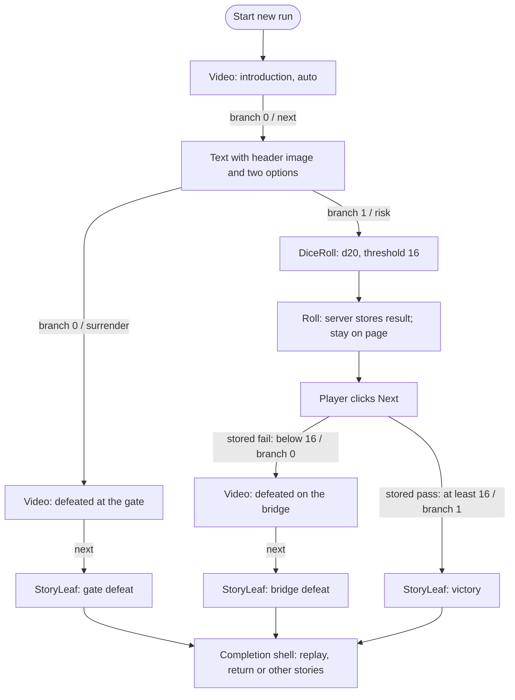
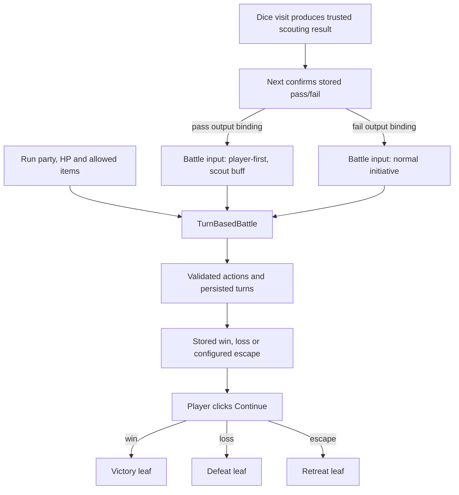
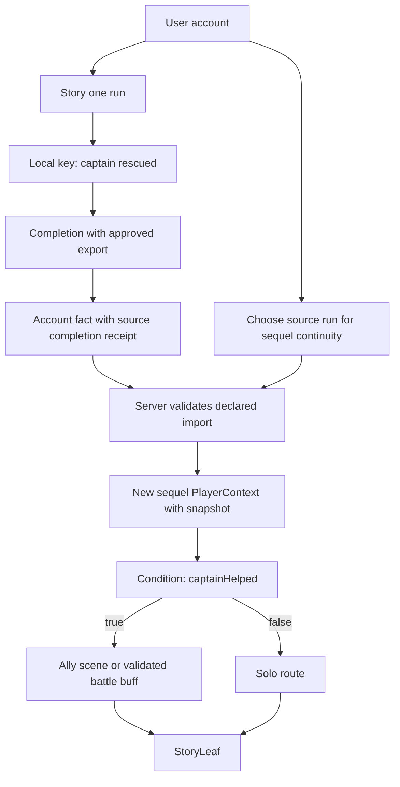
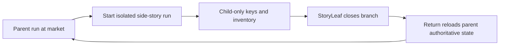

# Example stories and context flows

Status: design examples, not new fixtures or published stories. These diagrams illustrate [StoryNodes](story-nodes.md), [type contracts](page-types.md), [contexts](architecture.md) and [keys](keys.md). Current wire names differ from target conceptual names where noted.

## Video, options, dice and endings

The requested example starts with a linear video, then a text page with a header image and two options. Option 0 leads to one defeat; option 1 asks for a d20 roll of at least 16. Dice Roll displays its result, and **Next** follows the stored branch. Both defeat branches and victory lead to explicit leaves.

| Node | Input/config | Stable output ID and display ordinal | Destination |
| --- | --- | --- | --- |
| `intro` | Video asset; auto advance | `next` / 0 | `choice` |
| `choice` | Header image and body | `surrender` / 0; `risk` / 1 | `defeat-gate`; `roll-bridge` |
| `roll-bridge` | Sides 20, threshold 16 | `fail` / 0; `pass` / 1 | `defeat-bridge`; `victory` |
| `defeat-gate` | Defeat video | `next` / 0 | `gate-leaf` |
| `defeat-bridge` | Different defeat video | `next` / 0 | `bridge-leaf` |
| Each leaf | Ending presentation and story completion | None in the story graph | Shared completion shell |

For current implementation, Text with Options is `text-options`, DiceRoll is `dice`, the threshold is `outcome.target`, and leaves map to eligible `kind: "ending"` pages. Defeat video and leaf may be one ending Video placement when no separate post-video screen is needed. Named target result bindings are not yet supported by today's `lastRoll`-only model.

### Concrete run traces

1. Roll **14**: Roll persists `{value: 14, sides: 20, threshold: 16, passed: false}` on the dice visit. Reload still shows 14. Next selects `fail`, plays the bridge-defeat video, then closes at its leaf.
2. Roll **16**: The threshold is inclusive. Next selects `pass` and enters the victory leaf.
3. Roll **20**: Same pass branch. The result remains 20 if the following node explicitly binds to it; it is not replaced by branch number 1.
4. Choose **surrender**: No roll occurs. The gate-defeat video and leaf complete that branch.
5. Retry a timed-out Roll: Reuse its key and get the stored result. Retry Next: Reuse its key and do not skip a second node.

The numbers 14/16/20 are deterministic test inputs, never browser-supplied outcomes in real play.

## Passing a result into a future battle

The edition declares the mapping from the scouting result to initiative and the registered buff. The browser sends an action/target intent. It cannot invent `preemptive: true`, a buff magnitude, a damage total or `won: true`. A visit resumed mid-battle restores its current turn, resources and accepted input. Turn-limit exhaustion has an authored terminal disposition. This is a target example; combat remains unimplemented.

## Sequel and account context

The sequel receives only `captainHelped` plus provenance needed for validation. It does not inherit all keys/items or mutate the original run. An optional missing import can default false; a required missing import prevents start with an explanation. A subscription check remains a separate live permission and cannot be substituted by this narrative snapshot.

## Child branch and parent return

The parent run ID and entry revision are references, not an invitation to overwrite the parent's current save. If another device advanced the parent, return uses its newer state. Child inventory is not merged. An unavailable parent still leaves replay/discovery exits.

## Invalid graphs that publication must explain

| Invalid case | Why it fails | Safe correction |
| --- | --- | --- |
| Empty draft published | No playable entry or leaf | Save it as a draft; add nodes before publishing |
| Video option points to a deleted page | Dangling output | Reconnect explicitly or remove the option |
| Every option requires a key the run cannot have | Conditional dead end despite structural leaf reachability | Add a usable fallback or correct eligibility |
| Auto video A → B → A forever | Automatic cycle with no finite completion policy | Add a bounded exit leading to a leaf |
| Dice roll auto-routes immediately | Violates result/confirmation lifecycle | Persist/display Roll, then route on Next |
| Battle input accepts only a roll but one incoming edge is Text | Incompatible input on one predecessor | Add explicit mapping/default or change the graph |
| Ad provider unavailable with no exit | External dependency traps the story | Bind unavailable/skip fallback |
| Creator key named premium grants paid access | Namespace label lacks issuer authority | Use verified entitlement projection |
