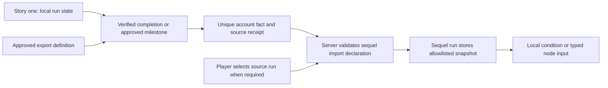

# Keys, items, achievements and cross-story imports

Status: target contract. Decisions S04, S06 and S09. Current runtime supports story-namespaced local keys/items/milestones/scores, and rejects foreign namespaces. Export/import registries and commercial entitlements are not implemented.

“Key” is a creator-facing idea for a fact or right used in a condition. Storage and authorization distinguish several kinds; a single unrestricted boolean map is not sufficient.

## Kinds and ownership

| Kind | Example | Authoritative scope and issuer | Lifetime/consumption |
| --- | --- | --- | --- |
| Narrative key | `harbor:brass-key` | One run; validated story effect | Persist for run, revoke/consume only by declared local effect |
| Inventory item | `harbor:health-potion`, quantity 2 | One run; validated bounded inventory rules | Consumable quantity, atomic cost; never a boolean pretending to be a count |
| Milestone/score | Chapter visited, quiz score | One run; rules/effects in pinned edition | Declared effect cadence; scores bounded and generally hidden |
| Exported achievement fact | `harbor:saved-captain` | User account; approved export definition and verified source event | Usually non-consumable; explicit revocation policy |
| Promotional key | Event access, limited redemption | User account; platform/authorized campaign issuer | Expiry, redemption limit and revocation policy required |
| Subscriber/premium key | Active premium tier | User account; verified entitlement service | Live expiry/revocation checks; cannot be permanently copied as a local fact |
| Paid access/item right | Purchased chapter or pack | User account; verified payment/fulfilment service | Issuer's quantity/refund/revocation policy; no browser-created grants |
| Platform achievement | Curated account XP award | Account progression service | Approved definition and globally unique claim scope |

Subscriber and premium may be labels for the same entitlement system, not separate sources of truth. A local item may be earned in a story, but converting a paid account inventory unit into a local item would require an explicit transfer protocol and unique fulfilment record. That is deferred.

## Definitions and grants

Current StoryLeaf completion supports labeled local keys only, with a versioned configuration and an embedded durable completion receipt in the run. The server grants them once on completion, recording which were already held; replay is a distinct run and child rewards stay isolated. There are no account grants or sequel exports in this implementation. See [the local completion contract](story-nodes.md#local-completion-contract).

Target definitions declare a stable ID/namespace, definition version, kind/value schema, scope, issuer, eligibility, stacking/consumption, expiry/revocation behavior and export/import policy. Grants record subject, definition version, source run/event or verified provider reference, time, value/quantity, claim ID and current status. Separate the definition from each grant.

Use namespaces owned by the story or approved issuer. Current IDs use `story-id:key-name`; retain that supported syntax for current local state. A future registry may use structured namespace/ID fields, but must specify a versioned encoding. Merely spelling `platform:premium` does not authorize a creator to issue it. Runtime schemas reject undeclared IDs, unsupported value types and foreign references without contracts.

An exported achievement is a verified fact with provenance, not a pointer allowing another story to read an entire save. Avoid putting raw form responses, private narrative choices or payment data in export values. Public display and programmatic import are separate permissions.

## Sequel import contract

An edition declares every external dependency: source issuer/story, exported definition/version, allowed value type, target local alias, required/optional status, default if optional, source-selection rule and freshness policy. The service checks both the source's export permission and the destination's import permission. Creators cannot inspect arbitrary account facts.

For narrative continuity, use an explicit source run/completion receipt. If several eligible runs disagree, ask the player to select one at story start and persist that choice. A simpler achievement import may explicitly mean “ever earned”; it must not accidentally mean “latest run” or change during reload. Defaults and missing-source UI are authored behavior, not hidden guesses.

Example target declaration in plain terms: sequel input `captainHelped: boolean` imports `harbor:saved-captain` version 1 from the selected completed Harbor run. It defaults to false only if declared optional. A battle can bind that snapshot to an authored ally buff. The server validates the mapping; the sequel never mutates the original run or takes its inventory.

Do not weaken today's foreign-namespace rejection until the full export/import permission, persistence and verification path exists. Cross-story reads through client-side save searches are not an acceptable interim implementation.

## Snapshot facts versus live rights

| Use | Resolution policy |
| --- | --- |
| Which ending occurred in the selected prequel run | Snapshot source receipt/value at sequel start; retain provenance |
| Has this account ever earned an approved achievement | Snapshot or explicit live check according to the edition's declaration |
| Is the account currently subscribed / allowed to play paid content | Live authoritative check at start/resume/protected actions; bounded offline lease only after separate design |
| Has a consumable redemption already been used | Atomic check-and-consume in the issuer's authoritative store |

Revoking access does not erase story history. Integrity revocation of exported facts requires a defined handling policy for existing snapshots; it must not silently rewrite an immutable edition or past event. Define product behavior before release for refunds, expiry during a run, offline access and changed source visibility.

## Idempotency and abuse prevention

Different scopes need different uniqueness keys. A once-per-account achievement uses `(user, rewardDefinition, eligibilityScope)`, while a once-per-run local effect uses `(run, effectDefinition)` and a once-per-visit effect adds visit identity. Retain claim records independently of short-lived command receipts. Two devices, repeated publication, replay, checkpoint restore or a retried provider callback must not duplicate a grant.

Community child runs cannot automatically export platform progress or mutate their parent. Approved account exports use the same issuer and eligibility checks as root stories. Consumptions cannot race with grants to produce negative inventory or duplicate fulfilment.

## Verification scenarios

Verify local isolation across users and runs; rejected namespace spoofing; two concurrent claims yielding one grant; explicit source selection across conflicting prequel endings; optional defaults versus required import failure; incompatible definition versions; revoked/expired rights; replay without reward farming; and private exports excluded from catalogue/share/AI payloads.
