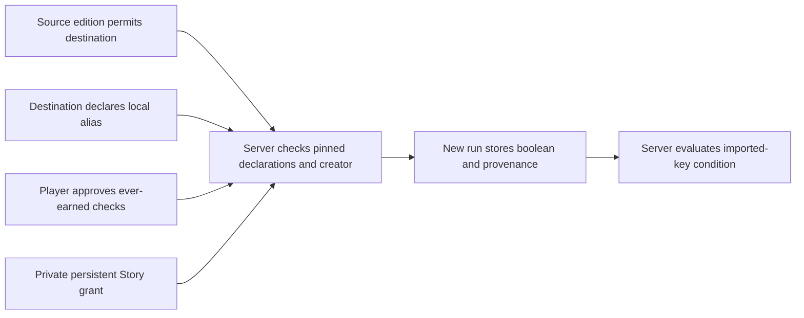
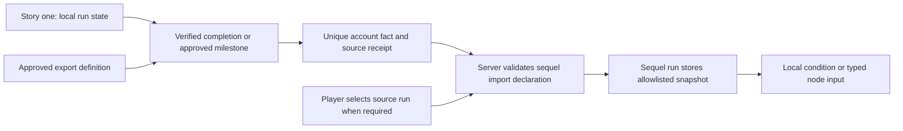
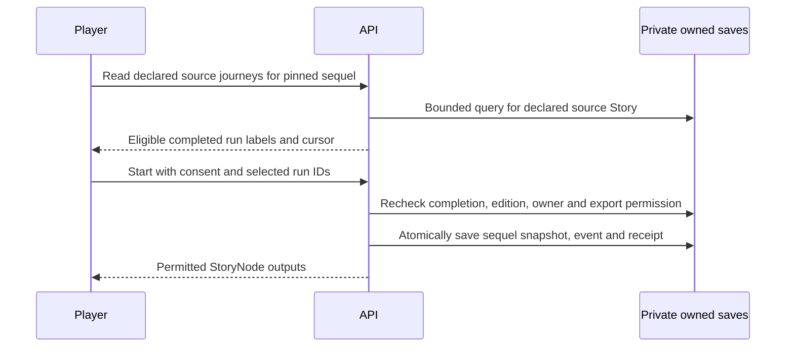
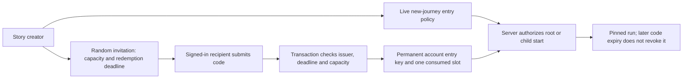

# Keys, items, achievements and cross-story imports

Status: target contract with implemented local state, persistent Player + Story keys, approved account achievements, invitation entry and consented persistent-key and selected-run local-key imports within one creator's Stories. Decisions S04, S06, S09 and S16–S22. General foreign namespace access, arbitrary value imports, cross-creator imports and commercial entitlements remain unsupported.

“Key” is a creator-facing idea for a fact or right used in a condition. Storage and authorization distinguish several kinds; a single unrestricted boolean map is not sufficient.

## Kinds and ownership

### Shared key model (S17)

A key is an issuer-owned definition plus a verified grant to a subject. Achievements record accomplishments and may award keys; invitations, gameplay and verified purchases can also award keys. A key check does not implicitly consume it. Consumable quantities require an explicit atomic cost contract. Definitions declare scope, issuer, permitted consumers, grant rules, expiry/revocation and consumption; grants retain subject, source event, definition/edition, time and uniqueness identity.

| Scope | Subject and lifetime | Example |
| --- | --- | --- |
| Playthrough (`run`) | One player run; separate on replay | Found item or opened door |
| Player + Story (`story`) | One account's progress in one Story across runs/editions | Five completions unlock bonus content on the sixth run |
| Account (invitation entry implemented; general `account` conditions deferred) | One account; only declared authorized consumers may check | Creator beta invitation, future paid option or subscriber access |

StoryContext owns definitions, never shared player ownership. Player + Story progress belongs to private UserContext storage; a run receives a bounded, immutable starting snapshot. Other accounts and Stories cannot read it. Stable key IDs retain their meaning across editions; renaming creates a new identity. Creators can define and award their own narrative keys without platform achievement approval. They cannot mint another issuer's keys or platform/premium rights.

Beta invitations now grant permanent permission to start the creator's Story; see the [invitation entry contract](#invitation-entry-contract). A future shop purchase may grant permission for Option C in that issuer's Story. Game 1 items require explicit export/import permission and source-run selection when needed before Game 2 can check them. Future subscription keys are live expiring rights checked at start, resume and protected actions; they are never made permanent by a run snapshot. Expiry preserves saves and offers a recoverable access screen; current content may finish, but further protected transitions require renewed access. Payment/refund/provider and offline-lease implementation remain deferred.

The server evaluates branch conditions when presenting options and again when accepting intent. Unavailable hidden branches disclose neither their option nor protected content; locked presentation may expose only an authored non-sensitive label. A disabled/expired conditional branch must retain a safe alternative. A whole-Story entry gate offers recovery before any protected content is fetched. Monetized keys may also be earned through gameplay only when their issuer explicitly permits that grant source.

### First implementation: persistent Story progress

`Story.progression: {version: 1, keys: [{keyId, label, afterCompletions}]}` declares up to 40 unique Story-namespaced permanent boolean keys, each awarded at a threshold from 1–999 completed runs. Counts include committed StoryLeaf completions after this feature is deployed, across editions and isolated child runs of the same Story. A watch means a completed run, not a reload, visit or raw video-play event. No historical completion backfill occurs. Existing completed saves stay unchanged.

On each new root/child run, the service snapshots only declared granted keys into server-only `Save.storyProgressSnapshot` (version 1, keys). Existing saves without it have no persistent keys. Active runs never change when another run earns a key. Conditions use `{kind: "key", scope: "story", keyId, present}`; absent scope or `run` uses existing local keys. Story-scoped conditions must reference declared definitions. Account scope is reserved and rejected by current schemas.

Completion atomically increments `users/{uid}/storyProgress/{storyId}.completions`, creates missing permanent grants under its `keys/{keyId}` subcollection with source run/edition/definition snapshot, and records `completions/{runId}` as a durable no-TTL deduplication receipt. These writes commit with the run/event/command receipt and any approved achievement. Thresholds use the completing run's pinned edition. Completion exposes only newly granted labels/IDs through optional `completion.storyKeys`; normal player responses omit the progress snapshot and total. No client writes or generic grant endpoint exist. Definition removal stops future snapshots/grants without deleting history. Reintroduction of the same ID recognizes its prior grant.

Studio authors these thresholds in StoryTrunk and selects persistent-key conditions on options; preview has an empty snapshot and cannot claim progress. Safe publication still requires an unconditional cost-free exit. Invitations are implemented separately below. S22 adds achievement-bound persistent keys below. Mid-run persistent awards, arbitrary typed imports, consumption, shops and subscriptions remain follow-on work.

| Kind | Example | Authoritative scope and issuer | Lifetime/consumption |
| --- | --- | --- | --- |
| Narrative key | `harbor:brass-key` | One run; validated story effect | Persist for run, revoke/consume only by declared local effect |
| Inventory item | `harbor:health-potion`, quantity 2 | One run; validated bounded inventory rules | Consumable quantity, atomic cost; never a boolean pretending to be a count |
| Milestone/score | Chapter visited, quiz score | One run; rules/effects in pinned edition | Declared effect cadence; scores bounded and generally hidden |
| Exported achievement fact | `harbor:saved-captain` | User account; approved export definition and verified source event | Usually non-consumable; explicit revocation policy |
| Promotional key | Event access, limited redemption | User account; platform/authorized campaign issuer | Expiry, redemption limit and revocation policy required |
| Subscriber/premium key | Active premium tier | User account; verified entitlement service | Live expiry/revocation checks; cannot be permanently copied as a local fact |
| Paid access/item right | Purchased chapter or pack | User account; verified payment/fulfilment service | Issuer's quantity/refund/revocation policy; no browser-created grants |
| Platform achievement | Curated account XP award | Account progression service | Approved definition and globally unique claim scope |

Subscriber and premium may be labels for the same entitlement system, not separate sources of truth. A local item may be earned in a story, but converting a paid account inventory unit into a local item would require an explicit transfer protocol and unique fulfilment record. That is deferred.

## Definitions and grants

### Approved account achievements

Current implementation policy: creators submit a title/description for one published StoryLeaf in one immutable edition; admins approve, reject or revoke that exact submission with an audit reason. Approval does not modify the edition and never grants paid access, XP, currency or subscriber rights. Definitions are private to their creator and admins. Approval is live eligibility at completion; it is not retroactive. StoryLeaf IDs form a stable achievement identity within a Story across editions; a new edition requires its own approval but cannot award the same achievement twice to an account.

The service atomically creates an account claim with the completion, preserving source run, edition, StoryLeaf, definition revision, time and display snapshot. The claim key is `(user, Story, StoryLeaf)` and has no TTL. Replay and concurrent runs return already-earned status. Revocation prevents new grants; existing historical claims are retained and marked revoked on account-list reads according to their source definition. Reapproval can restore that definition's active display status; rejection cannot alter an already approved definition. Account claims are private, paginated and API-only; they are not automatically exposed to other Stories, AI, public profiles or sequel imports. Legacy profile achievement strings remain separate and are not accepted as claim evidence.

Creator API: `POST /api/achievement-submissions` accepts `{idempotencyKey, expectedRevision, storyId, versionId, storyNodeId, title, description}`. The service checks ownership and the published leaf, snapshots its title/transcript/type for review and creates or resubmits pending/rejected metadata. `GET /api/achievement-submissions?storyId=&versionId=&storyNodeId=` retrieves the owned edition-specific submission; list/detail reads are also owner-only. Admin review is documented in [Admin](../20-admin.md). `GET /api/achievements?cursor=` lists up to 50 private claims with their current revocation status. Definitions and claims remain denied to direct Firestore clients under existing rules. IDs are SHA-256 digests of JSON-encoded identity tuples, not authority tokens. Commands use revision checks, bounded bodies, strict schemas and idempotency receipts; durable claims have no TTL.

The completion's optional `accountAchievement` is a historical grant/already-earned display snapshot, not a live entitlement assertion. Approved definitions are consulted inside the completion transaction, including direct-entry leaves and child runs. There is no post-completion claim endpoint or retroactive scan. Private Studio previews do not invoke this grant service. Source claims and completion receipts are never deleted on revocation, and existing editions and saves are not migrated.

StoryLeaf's authored reward configuration supports labeled local keys, with a versioned configuration and an embedded durable completion receipt in the run. The server grants them once on completion, recording which were already held; replay is a distinct run and child rewards stay isolated. Approved account achievements use the separate registry above; S20 supports declared run-local boolean exports. See [the local completion contract](story-nodes.md#local-completion-contract).

Target definitions declare a stable ID/namespace, definition version, kind/value schema, scope, issuer, eligibility, stacking/consumption, expiry/revocation behavior and export/import policy. Grants record subject, definition version, source run/event or verified provider reference, time, value/quantity, claim ID and current status. Separate the definition from each grant.

Use namespaces owned by the story or approved issuer. Current IDs use `story-id:key-name`; retain that supported syntax for current local state. A future registry may use structured namespace/ID fields, but must specify a versioned encoding. Merely spelling `platform:premium` does not authorize a creator to issue it. Runtime schemas reject undeclared IDs, unsupported value types and foreign references without contracts.

An exported achievement is a verified fact with provenance, not a pointer allowing another story to read an entire save. Avoid putting raw form responses, private narrative choices or payment data in export values. Public display and programmatic import are separate permissions.

## Sequel import contract

### Persistent-key imports (S19)

The first implementation imports permanent Player + Story keys between Stories owned by the same creator. It does not import run-local items, endings, approved account achievements, invitations or paid rights. Its explicit selection rule is **ever earned**, not latest run. S20 below extends this with an explicit source-run picker for local boolean facts.

A source edition's progression key may declare `exportToStoryIds` (at most 20 distinct saved Story IDs). A destination edition declares `keyImports: {version: 1, keys: [{keyId, label, sourceStoryId, sourceVersionId, sourceKeyId, required}]}` (at most 20 unique local aliases). The source edition and key identity are pinned; the source key must explicitly permit the destination, and both roots must belong to the same creator. Publication and new starts validate those permissions. Reserve/save the destination ID first, then publish the source export, then publish the importing destination. Export consent in an immutable edition is permanent for this narrative-fact contract; a later edition does not revoke older declarations or saved snapshots. Cross-creator sharing and integrity revocation need a separate live policy before release.

Before a root start, `GET /api/story-imports/{storyId}` checks catalogue visibility and entry access and returns only the current edition, title and declared import labels/source titles/required flags. It never reads grants or reveals inventory. The player explicitly chooses **Use earned keys** or, if all imports are optional, **Start without imported keys**. Start pins that displayed `versionId` and sends `importConsent: true` only for approval. The server resolves grants transactionally at start, never accepts client values, and rejects a missing required grant/consent before creating any run. Optional absent or declined imports default false. A stale displayed edition remains the explicitly selected immutable edition.

`Save.keyImportSnapshot` stores bounded local aliases, boolean values, pinned export references, resolution time, and grant source run/edition/time when present. It is server-only and separate from mutable local keys and persistent same-Story keys. `kind: key, scope: import` conditions require a declared local alias; local effects cannot forge the imported value. Permission failures fail closed even for optional imports; only a valid declaration's missing grant defaults false. Resuming and idempotent retries reuse the committed snapshot. Existing saves without it have no imported keys; no backfill or migration occurs. Preview starts with no imports and awards nothing.

S19 initially supported root starts; S21 now supports community child entry with separate explicit consent and parent-scoped authorization, without inheriting consent or parent state. Branches still require an unconditional safe route. No raw source saves, grant provenance or imported values enter player, catalogue, share or AI projections. Creators configure declarations in StoryTrunk and can use imported aliases in option conditions.

An edition declares every external dependency: source issuer/story, exported definition/version, allowed value type, target local alias, required/optional status, default if optional, source-selection rule and freshness policy. The service checks both the source's export permission and the destination's import permission. Creators cannot inspect arbitrary account facts.

For narrative continuity, use an explicit source run/completion receipt. If several eligible runs disagree, ask the player to select one at story start and persist that choice. A simpler achievement import may explicitly mean “ever earned”; it must not accidentally mean “latest run” or change during reload. Defaults and missing-source UI are authored behavior, not hidden guesses.

Example target declaration in plain terms: sequel input `captainHelped: boolean` imports `harbor:saved-captain` version 1 from the selected completed Harbor run. It defaults to false only if declared optional. A battle can bind that snapshot to an authored ally buff. The server validates the mapping; the sequel never mutates the original run or takes its inventory.

Do not weaken today's foreign-namespace rejection until the full export/import permission, persistence and verification path exists. Cross-story reads through client-side save searches are not an acceptable interim implementation.

### Selected completed-run imports (S20)

S20 extends S19 with `selection: completed-run` on an import; absent selection remains `ever-earned`. A source edition declares `runKeyExports: {version: 1, keys: [{keyId, label, exportToStoryIds}]}` with at most 20 unique run-local key definitions. These export the boolean presence of the named local key at completion, including StoryLeaf rewards, never item quantities, imported aliases, persistent account keys or full saves. Namespace, same-creator, explicit destination and immutable permission checks remain mandatory. Across persistent/run export definitions, allow at most 20 distinct destination Stories.

The player chooses one completed run for each source Story/edition pair; all imports from that pair use the same run, preventing contradictory endings from being combined. Nothing is preselected, even when only one run is eligible. For completed-run imports, `required` means a completed source journey must be selected, not that the imported boolean must be true. A selected run where the key is absent is a valid false fact. Optional omitted selections default false. Approval is still explicit and includes any ever-earned checks in the same offer.

`GET /api/story-imports/{destination}/{edition}/runs?keyId={alias}&cursor=` validates destination entry access and the pinned import/export declarations before listing the signed-in account's eligible completed runs. Query at most 20 owned records for the declared source Story in document-ID order, then filter to the exact source edition and a durable completion receipt. Return only run ID, completion time and ending title; never source keys, answers, inventory or imported values. An empty batch may have a next cursor. The picker offers Load more and an error/retry state. This read authorizes no import; the player confirms the selected journey afterward.

Start accepts bounded unique `sourceRuns: [{sourceStoryId, sourceVersionId, runId}]` only with `importConsent: true` and an explicit destination `versionId`. The server rejects undeclared source pairs, another account's run, active/legacy-without-receipt runs, mismatched source editions and duplicate selections. It revalidates the owned source run in the new-run transaction and snapshots only declared boolean values plus run ID, completion revision/time and ending ID. Exact retries replay the original selection; a changed selection under the same command key conflicts. Reload and replay of the source cannot change an existing sequel snapshot. No historical saves or immutable editions are rewritten. Source runs from before export publication cannot satisfy a newer export edition.

Studio exposes run-local exports and the import selection mode. Start consent groups the run pickers by source Story/edition. Existing persistent imports preserve their behavior. S21 below adds community child consent. Cross-creator sharing, quantities, paid rights, run-to-run mutation and integrity revocation remain deferred.

### Community side Story imports (S21)

Entering a community side Story uses the same S19/S20 declarations, explicit consent and owned completed-run selection as a root start. Consent is per new child run; it is never inherited from the parent. Same-creator permission relates the import source to the child Story, not to the parent creator. Parent keys, inventory and import snapshots are not copied or merged.

The offer and source-journey listing are scoped to an owned active root run, its expected revision, current branch location and the selected community branch record. `GET /api/playthroughs/{parent}/branches/{branch}/imports?expectedRevision=` returns declarations for that branch's exact child edition. Appending `/runs` also requires child `storyId`, `versionId` and `keyId`, and retains S20's bounded private projection. Neither route requires the child to appear in the public catalogue. Both enforce the child's live entry policy.

The branch command accepts optional child `storyId`, `versionId`, `importConsent` and `sourceRuns`; consent or selections require the displayed child Story and edition. Imported children require that pin even when consent is declined. The transaction repeats parent revision/location, branch edition and entry checks before resolving imports and creating the isolated child save, event and receipt. A changed parent or branch edition rejects the attempt so the player can reload and request a fresh offer. Exact committed retries return the original child even after the parent advances. Existing commands for children without imports remain accepted. Existing saves and editions are unchanged.

The shared consent dialog uses an authorized child picker endpoint. Cancel creates no save. Loading uses the existing player overlay/reserved space; entering and returning still use the shared Story/StoryNode lifecycle. No cross-creator imports, paid rights or automatic parent fact transfer are introduced.

## Snapshot facts versus live rights

### Invitation entry contract

S18 implements one narrow account key: permanent permission to start a named Story. Its subject is the account and its issuer is the Story creator. Only the creator with publishing capability can configure entry policy or issue/disable invitations. This does not enable generic `scope: account` conditions or issue platform, premium or foreign rights.

Live `stories/{storyId}.entryPolicy: {version: 1, revision, invitationRequired}` is separate from immutable narrative editions. The default is open. Creators can set it after saving a draft, before the first publication, so beta access need not have an open publication window. Gate changes require the expected policy revision and an idempotency key; they affect all new runs, including explicit old-edition starts and child starts. The owner bypasses their own entry gate. Saved runs remain readable/playable, and private Studio preview is unaffected. Catalogue metadata and public shares remain public.

Creators issue a cryptographically random code with 1–1000 redemption slots and 1–30 days to redeem. The server stores only its SHA-256 digest as the invitation identity, plus issuer, Story, creation/expiry, limit, count, revision and disabled status. The creator command receipt temporarily retains the returned code for exact retry; list responses never reveal codes. Codes are manually copied/shared, never put in URL query strings or automatically sent to followers.

Redemption requires an active signed-in account, the intended Story and the code. In one transaction the service validates issuer/Story, active status, deadline and remaining capacity; creates `users/{uid}/storyEntryKeys/{storyId}` with source invitation/issuer/time; and increments the invitation count. Grants have no TTL. An existing grant returns already-granted without consuming another slot. Different accounts racing for the final slot cannot both succeed. Bad/expired/disabled/exhausted codes receive the same safe error. There is no client-write path, transfer, billing, refund, consumable key or key revocation in this slice.

`GET/POST /api/story-invitations/{storyId}` provide owner administration; `GET/POST /api/story-entry/{storyId}` provide a minimal access projection and redemption. New-run authorization reads the policy and grant inside the same command transaction before creating the run or projecting content. Changing the policy cannot be bypassed by requesting an older edition. A retry of an already-committed start still returns that existing journey.

Invitation access controls participation. Existing static sample media, public reusable StoryNode shares and Firebase download-token URLs are not revocable private media. A creator is explicitly told that existing journeys and shared media stay accessible. Expiring subscriptions and confidential/paid media need a separate delivery/lease design before implementation; they cannot reuse this permanent-entry grant as proof of live entitlement.

| Use | Resolution policy |
| --- | --- |
| Which ending occurred in the selected prequel run | Snapshot source receipt/value at sequel start; retain provenance |
| Has this account ever earned an approved achievement | Snapshot or explicit live check according to the edition's declaration |
| Is the account currently subscribed / allowed to play paid content | Live authoritative check at start/resume/protected actions; bounded offline lease only after separate design |
| Has a consumable redemption already been used | Atomic check-and-consume in the issuer's authoritative store |

Revoking access does not erase story history. Integrity revocation of exported facts requires a defined handling policy for existing snapshots; it must not silently rewrite an immutable edition or past event. Define product behavior before release for refunds, expiry during a run, offline access and changed source visibility.

## Idempotency and abuse prevention

Different scopes need different uniqueness keys. A once-per-account achievement uses `(user, rewardDefinition, eligibilityScope)`, while a once-per-run local effect uses `(run, effectDefinition)` and a once-per-visit effect adds visit identity. Retain claim records independently of short-lived command receipts. Two devices, repeated publication, replay, checkpoint restore or a retried provider callback must not duplicate a grant.

Community child runs cannot automatically export platform progress or mutate their parent. Approved account exports use the same issuer and eligibility checks as root stories. Consumptions cannot race with grants to produce negative inventory or duplicate fulfilment.

## Verification scenarios

Verify local isolation across users and runs; rejected namespace spoofing; two concurrent claims yielding one grant; explicit source selection across conflicting prequel endings; optional defaults versus required import failure; incompatible definition versions; revoked/expired rights; replay without reward farming; and private exports excluded from catalogue/share/AI payloads.

## Achievement-bound persistent keys (S22)

A persistent key definition declares exactly one trigger: existing `afterCompletions`, or `achievementStoryNodeId` naming a StoryLeaf in the same edition. The latter grants only on an approved completion at that leaf. It remains a permanent Player + Story narrative key, not a general account entitlement. Existing namespace, 40-key bound, safe-output and explicit export/import rules apply. Studio authors the trigger in StoryTrunk.

Submission derives a bounded `rewardKeys` projection (key ID and label) from the published edition; the client cannot submit reward values. Creator and admin views show these bindings before approval. Approved definitions are immutable. Definitions predating S22 without reward bindings grant no keys; a new edition/submission is needed to add them.

Completion reads the exact edition's approved definition, then prepares achievement claims and progress grants before writing. The matching approved binding and the edition must agree. Claim, permanent key, progress completion receipt, save, event and command receipt commit atomically. Each key is unique per account/Story/key ID, while achievement claims retain their existing account/Story/leaf uniqueness across editions. Replays, concurrent runs and exact retries cannot duplicate grants or change their provenance. A later approved edition may bind a new key: an account with the achievement already claimed earns that key only on a future qualifying completion, never by retroactive backfill.

Pending/rejected/revoked definitions grant no achievement-bound keys. Revocation stops future awards but retains already earned permanent narrative keys and saved import snapshots. This is not a revocable subscription or paid-content mechanism. The completion shows newly granted keys through existing storyKeys; next runs snapshot them, existing runs keep their starting snapshot. Child completion grants only its own Story's keys, never parent keys. Preview cannot grant persistent state.
