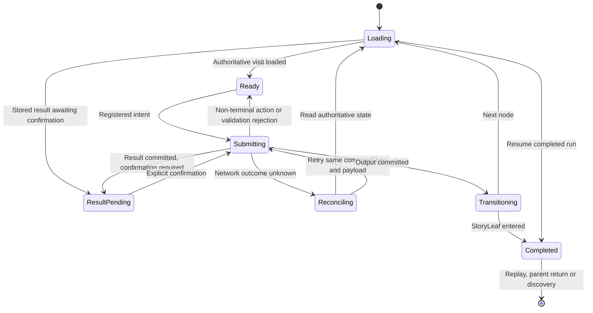

# StoryNode rendering and the shared StoryNode lifecycle

Status: target lifecycle with preserved current invariants. Read [type contracts](node-types.md) and [current behavior](../16-story-nodes.md). Decisions: S01, S03, S05, S07.

The active StoryNode is presented by its type's renderer. Every renderer, including a future battle, form or advertisement, is a child of the shared `StoryNode` component and runs in `Story` context. The portable data type describes the placement; the shared component manages its rendering lifecycle. The wrapper owns shared busy/offline/error behavior, output dispatch, focus, accessibility and completion controls. A renderer owns its type-specific presentation and interaction controls, emitting only registered intents through that wrapper. The StoryTrunk title/configuration view is outside the playthrough and does not create a gameplay visit. Use [the canonical terminology](terminology.md) for graph concepts.

The current [player runtime](player-runtime.md) implements session ordering, evaluated output presentation and combined command responses. The generalized visit lifecycle below remains a target; revision-scoped rendering does not establish durable visit identities.

## Inputs and intents

Each StoryNode receives the pinned node config, validated resolved input, safe story/user projections and its current run/visit state. Read-only input does not confer permission to write those objects. UI-local values such as a hover, media time or an unsubmitted form edit remain transient unless the type explicitly defines a persisted draft.

An intent identifies the permitted action and bounded user input. It never supplies trusted destination IDs, selected random values, damage totals, reward amounts or entitlement flags. The service derives those from the edition and authoritative state. A choice ID is an intent to choose that option, subject to revalidation. Local disabling and debouncing improve UX; server idempotency provides correctness.

Target output projection omits disabled StoryBranches whose paths cannot reach a StoryLeaf, including their buttons and video overlay options. Studio shows the diagnostic to the creator; the player does not see an unfinished option. The server rejects direct or stale invocations of those branches. An ordinary unmet condition on a valid path can use the declared locked/hidden policy. See [graph validation](story-nodes.md#storyleaves-and-termination) for required outcomes and upstream suppression.

## Lifecycle

Loading an existing pending interaction restores it from the server. It must not roll, award effects or finish a battle again on mount. A network timeout is an unknown command outcome: retry with the same command key or reload before issuing a new action. A stale revision refreshes state and asks the player to act on what is current. Do not automatically replay a different choice on the new state.

The target distinguishes a visit ID from a node ID because loops can revisit a node. Pending results and callbacks must belong to the active run and visit. Changing run, node or visit invalidates stale media callbacks and speculative preloads. Current code has save revisions and `lastRoll.storyNodeId`; durable visit identity is a future contract expansion.

## Completion rules

| Interaction | Completion |
| --- | --- |
| Linear Text/Comic | Next triggers the single authored output |
| Linear Video, auto | Natural completion OR Next invokes the same idempotent route command |
| Linear Video, continue | Explicit Continue; natural completion alone stays on the frame |
| Text/Video with options | Only an explicit available choice selects its output; video completion cannot choose for the player |
| DiceRoll | Roll commits and displays the result in place; a separate Next consumes its stored Pass/Fail output |
| Reveal | Reveal asks the server to choose the result from saved scores |
| Future battle | Valid actions persist each turn; terminal outcome is stored, then Continue follows the stored output |
| StoryLeaf | Committed entry closes the run once; shell offers replay, return or discovery |

Autoplay restrictions do not count as narrative failure. Provide play/continue controls consistent with the configured mode. A duplicate ended/Next callback must not move two nodes. Rewarded-ad playback needs verified provider evidence; ordinary video playback has no such authority requirement.

## Layout and recovery

### Animated d20 presentation

The dice child renderer lazily loads a procedural Three.js d20 only for twenty-sided rolls. An accepted Roll intent starts a cosmetic tumble while the existing server command persists the outcome. The model settles with that saved value facing the viewer; animation never generates a result or dispatches an output. Next becomes available with the authoritative result and may skip the remaining animation. Reload restores the saved face without replaying the tumble.

The die and accessible result occupy one fixed-size region in every state. Reduced-motion users receive a static face; unsupported WebGL, failed module loading and other dice sizes retain the numeric display. Request errors stop the tumble without inventing an outcome. Hidden tabs stop animation, and leaving the node releases graphics resources. The renderer does not alter commands, save schemas, routing or transition timing: `content-paint` still measures the reading view, not completion of cosmetic animation.

Implementation review (October 25, 2026): read root/scoped instructions, CONTRIBUTING, documentation workflow, Story index/terminology, current contract, rendering, type, graph, player-runtime and design-system documents, with the context/storage and examples/current-state reading set from the preceding runtime work. This change implements d20 presentation only; StoryLeaf rewards and general type/visit contracts remain deferred. No service, portable contract, save, edition or routing changes. Self-review completed; independent review pending.

Verification: 111 unit tests, TypeScript and production build passed. Geometry checks cover all twenty upright faces and opposite-face numbering. Emulator-backed mixed StoryNode checks passed at desktop/mobile widths. The new CI browser flow checks delayed Roll, keyboard input, saved result, fixed layout, identical-command retry after a failed request, static reload, separate Next, reduced motion and WebGL initialization/context-loss fallback in both themes at 390/1440 pixels. Desktop/mobile screenshots were inspected. Service integration tests were not rerun for this presentation-only change. Non-d20 and failed-module fallbacks were reviewed but not separately browser-tested; real-device Safari and production performance remain unverified. Three.js is a separate lazy chunk (about 132 KB gzip); the build reports size warnings for that chunk and the existing application chunk.

Keep the player frame stable. Loading uses a fixed overlay or reserved placeholder, never a banner inserted above content. Existing video transitions retain the current frame with screen-reader loading status. Type transitions preserve media authorization where needed and respect reduced motion.

Dice feedback replaces the centered dice display within reserved space, appears only on its pending visit, survives reload and goes into the story log afterward. Transient notifications overlay the layout. Reading StoryNodes have accessible headings, image alternatives and keyboard outputs. Videos provide available captions/transcripts; comics have a defined reading order and editable text separate from artwork. Forms and battles require keyboard navigation, readable status and focus restoration.

During an offline or unknown-result state, retain the last authoritative StoryNode and expose retry/save navigation. A failure must not turn an ad into a paid reward, a battle into a win, or a missing asset into an authored route. The type must define any semantic fallback route; infrastructure errors use recovery UI. Save-and-leave exits the session without claiming the story has completed.

## StoryLeaf completion, child Story return and preview

Entering a StoryLeaf commits completion and its authorized end-of-path rewards under the declared claim scope, then offers replay and recommendations. Viewing or remounting the ending presentation cannot claim rewards again. Following an ordinary StoryBranch only navigates within that run. Replay creates a new run ID pinned to an explicitly selected edition; existing saves remain intact. Starting a different Story creates separate context. A completed child Story offers return to its recorded parent; the parent is reloaded and no child state is merged. Missing or unavailable parents still leave replay/discovery exits.

Public reusable-StoryNode previews and Studio previews use the same wrapper in a disposable context. Their outputs close or navigate within the preview; they neither impersonate a real save nor award account progress. A future interactive type is incomplete until its preview limitations and shared-wrapper browser path are documented.
