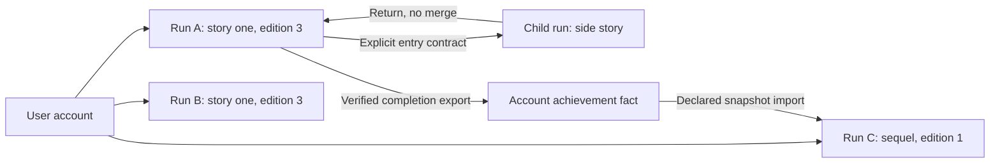

# PlayerContext: one story run

Status: target design, with current `Save` as its foundation. Decisions S04–S07 and S09. A PlayerContext is a **single user's single run of a pinned Story edition**, not the account profile and not a global character shared by all stories.

## Owned data

| Field group | Target contract | Current mapping |
| --- | --- | --- |
| Identity | Run ID, owner UID, story/edition/rules versions | `Save.id`, `playerUid`, `storyId`, `versionId`, `rulesetVersion` |
| Position | Current node and visit ID; run revision/status | `storyNodeId`, `revision`, `status`; visit ID deferred |
| Entry snapshot | Starting stats and explicitly imported facts with provenance | `statsSnapshot`; generalized imports deferred |
| Local progress | Stats, health, keys, inventory, scores, milestones, bounded variables | Existing local state; generic variables deferred |
| Interaction | Pending dice, form response draft, battle turn/state, bound node input | `lastRoll`; other type state deferred |
| Effects and history | Once-per-run/visit markers, immutable transition events, claim refs | `appliedEntryEffects` and event log; generalized cadence deferred |
| Parent relation | Parent run and entry revision, explicit import policy | `parentPlaythroughId`, `parentRevision`; no local-state merge |
| Completion | Ending ID, completion time, export/reward receipt refs | Completed status and versioned `completion` receipt for local keys, approved account achievement outcome and newly earned persistent Story keys; S20 can use this run as evidence for declared local boolean exports |

Current names remain valid until a versioned change implements the target. Do not put future fields into existing strict schemas without migration/version planning.

## Starting and resuming

S20's completed-run imports add optional per-key `sourceRun` provenance (run ID, completion revision/time and ending ID) to `keyImportSnapshot`. One chosen run supplies all local facts from a source edition. A new source replay never changes a saved sequel. The selection is command intent, validated against the actor's completed save and both editions' declarations; the browser cannot provide trusted values. See [selected-run continuity](keys.md#selected-completed-run-imports-s20).

S19 adds optional server-only `keyImportSnapshot` for consented, ever-earned persistent Story keys. Values and grant provenance are frozen at root start or explicitly consented child entry (S21), separate from mutable local keys and same-Story progress. Old saves without the snapshot resolve imports as false; resume never reads another Story's grants. See [imports](keys.md#persistent-key-imports-s19). Selected-run local facts are supported by S20; generalized values remain deferred.

Persistent Player + Story progress is separate from this single-run context (S17). New runs receive a server-only `storyProgressSnapshot` containing only the pinned edition's declared, previously granted permanent keys. Existing saves without it resolve those keys as absent; another run's awards never change an active run. Child runs snapshot their own Story's progress, without inheriting the parent's keys. See [persistent Story progress](keys.md#first-implementation-persistent-story-progress).

Starting a root run validates user access, selects a published edition, snapshots account stats, resolves declared imports and applies entry effects once. A missing optional import gets its declared default; a missing required import produces a clear eligibility message before creating the run. Each new run has a separate ID and inventory. A restart never resets account-level reward claims or creates new paid rights.

Resume reuses the saved edition, input snapshots, node/visit and pending state. Re-evaluate live access/entitlement checks at their documented boundaries, while leaving stable narrative imports unchanged. A completion fact from a previous story is usually snapshotted at start; an active subscription is not a permanent fact to copy into a run. See [keys](keys.md).

The account's later stat upgrades do not silently alter a saved run. Local stat effects alter only the run. A new root run takes a fresh snapshot. Child runs follow their explicit entry contract; today's child start copies parent stats, starts fresh local keys/items and never merges them back.

## Result passing and visits

A node visit receives resolved, schema-validated input and stores its binding provenance. A completed interaction produces a typed result; routing and declared edge mappings determine what reaches the next visit. Keep result snapshots bounded. Large form/battle details live in private associated records, with only an allowlisted projection passed forward.

Dice Roll and Next are separate commands. Pending state includes the visit that produced it; returning to the same node is a new visit and cannot reuse a previous pending action accidentally. Persist enough state to reproduce interpretation on reload. Latest-result convenience fields are projections, not the sole durable evidence for every prior interaction.

## Concurrency, replay and child Stories

Following a StoryBranch between playable placements keeps the same PlayerContext. The StoryTrunk is the title/configuration root outside the playthrough: run visits begin at the playable destination of its start connection, not at the trunk. Current `entryStoryNodeId` still identifies that first playable placement. Only an explicit launch of a separately authored child Story creates a child run. See [terminology](terminology.md#different-meanings-of-branch).

Each mutating intent includes an expected revision and idempotency key. Two devices cannot commit different choices from the same revision. A stale response refreshes the run; it does not merge local client guesses. Reload during a submitted command checks authoritative state or retries the same key.

Returning from a child reloads the parent's current revision. If another device advanced it, resume that authoritative state and explain the change; never overwrite it with the revision recorded when the branch opened. Completing, leaving or abandoning the child does not consume or grant parent inventory unless a future explicit exchange contract is designed and validated.

Checkpoint restore is a future capability: it may restore local state under its versioned policy, but cannot roll back account purchases, regrant claimed rewards or erase durable claims. Restoring produces a new run revision/history event, not a history rewrite. Its roll/visit replay semantics must be decided before implementation.

## Required checks

The player can inspect positive run-local quantities in a fixed inventory drawer. New Story log events show net item changes with edition-pinned names; old events have no reconstructed changes. See [S29 inventory](player-runtime.md#owned-inventory-and-item-history-s29). Account keys and other runs' inventories remain separate.

Test two independent runs, version-pinned resume, same-command retry, stale actions, pending-result reload, revisiting a node, once-only effects, parent changes during a child run and unavailable parent recovery. Sequel tests must demonstrate explicit source selection and isolation from unrelated runs. Preview cannot persist any of these account/run mutations.
