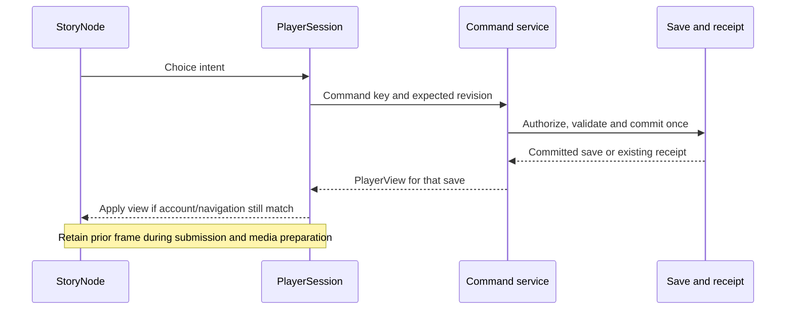

# Story player runtime

Status: implemented in the working branch; verification below. This change implements the player runtime first, as requested. It preserves the existing edition/save format and gameplay rules. StoryTrunk editing, selective unfinished-branch suppression, generalized rewards and new node types remain deferred.

## Ownership and authority

The application shell owns navigation and authentication. A dedicated player session owns loading, command submission, reconciliation and the last authoritative view. The shared provider exposes `useStoryContext()` for pinned identity, `usePlayerContext()` for the active run projection and `useUserContext()` for the explicit account projection. These are logical views of one composed context, not new persisted records. The shared Story provider composes them for the shared StoryNode lifecycle. Preview adapts authored data into the same rendering contract in a disposable context.

Renderers receive presentation and server-evaluated output availability. They do not need destination IDs, conditions, effects, quiz scoring rules or the rest of the graph. They emit choice intent only. Authority remains in the portable rules and authenticated transaction service.

## Transitions

A client negotiating `X-Story-Player: player-view-v1` receives `{player: PlayerView}` from a successful command and `PlayerView` from the run GET. A successful command returns the committed player view in the same HTTP response. The client applies that view without a second player GET for in-run transitions. Starting a different run navigates into a fresh session and loads it once. Unknown outcomes retain the exact command key and payload for retry; stale revisions require reconciliation. Responses belonging to another account, navigation or newer request cannot replace the active view. Pending dice remains on its node until a separate Next command.

Keep the current player frame while submitting and preparing media. Immediate control feedback acknowledges intent without predicting a destination or outcome. Failed media has the existing transcript/retry recovery. Starting or returning to another run replaces the session rather than mixing state.

## Caching and disclosure

The edition cache is a process-local LRU of at most 32 entries with a 60-second TTL. Its key includes the edition path and precise manifest update timestamp; the manifest readiness check still runs on every access. Only complete validated immutable definitions are inserted. Never cache player state, authorization or mutable publication pointers as edition data. Failed/partial edition loads are not cached. Cached objects cannot be mutated by a caller. Each request still validates identity and access; commands still validate the current run revision.

Anything sent to the browser is inspectable. Speculative media is a disclosure decision, not a security boundary. Keep preloading bounded to an explicitly permitted deterministic next asset, respect data-saving preferences and invalidate obsolete preparation. The new representation omits routes, effects, condition expressions, scoring mappings and private score totals. Hidden options are omitted; visible options carry server-evaluated condition/item-cost availability. The older representation remains available for compatibility, and save-list/history endpoints are not redesigned here: this is not a global secrecy boundary. Browser readiness is distinct from API completion; preloading cannot commit progress.

## Verification and compatibility

Preserve the existing client representation through explicit format negotiation while the new runtime uses a versioned rendering projection. Old receipts remain replayable without reexecuting actions or rewriting editions. Verification covers response projection, same-key retry, stale/concurrent actions, pending dice, account/navigation races, cache isolation/eviction/expiry and desktop/mobile frame retention. The browser transition check counts requests and records click-to-playing time; production API/decoder timing instrumentation remains future work. No production latency promise follows from local timing alone.

## Implementation map

- Portable presentation contract: packages/contracts/player.ts; pure projection: packages/domain/player.ts.
- PlayerSession owns request sequence, submission lock, exact uncertain retry, stale state and authoritative view. main.tsx owns navigation, authentication and shell errors.
- services/api/player-view.ts builds media and context projections for GET and command responses. Projection failure after commit returns a retryable error; replay uses the receipt save rather than reapplying the command.
- The cached edition is cloned on insertion/read. User projections, saves and mutable catalogue pointers are never cached here.
- StoryNode adapts Studio input locally; published renderers consume evaluated outputs without evaluating server routes. ScenePlayer retains the existing element/frame while loading media. Preloading remains one deterministic, unconditional, cost-free next clip and is skipped for Save-Data.

Reading set: root/scoped AGENTS, CONTRIBUTING, documentation workflow, current StoryNode contract, architecture, StoryNodes, rendering/types, Story/Player/User contexts, storage, keys and decisions S04/S05/S07/S08.

## Documentation-impact review and verification

- Documentation reviewed: root/scoped AGENTS, CONTRIBUTING, development workflow, Story index, terminology, architecture, StoryNodes, node types/rendering, Story/Player/User contexts, keys and data/storage; current contract and design system. Preserve server authority, immutable editions, version-pinned saves, isolated child runs and separate Dice Roll/Next.
- Contract impact: new versioned presentation projection, shared session controller and edition cache; index, component guide, rendering/current contract and decisions updated together. Persisted editions, saves and command receipts are unchanged.
- Current/target gap: trunk authoring, conditional unfinished-path suppression, general typed output bindings, durable visit identities, cross-story imports and rewards remain deferred. Compatibility endpoints still expose the older representation. This is not a complete spoiler-secrecy migration.
- Verification: TypeScript, 105 unit tests and production build passed. All 39 emulator integration tests passed, including old receipt negotiation, exact replay and projected Dice Roll/reload/Next. The build retains its existing large-chunk warning.
- Browser verification: delayed transitions at 1440/390 pixels used one POST and zero follow-up run GETs, retained the video element and stable geometry. Local click-to-playing was 2024/2048 ms with injected 800 ms command and 800 ms media delays; these are not production benchmarks. Mixed StoryNodes/dice reload, shared video previews, desktop/mobile quiz results/reload plus Studio quiz scoring/preview, and the full seven-width player suite passed, including child runs, retry/stale/offline and endings. The mobile dice screenshot was inspected.
- Verification limit: Studio reached its later AI-writing section after preview/publication/playback, then timed out looking for the “Write it” button; the full Studio suite is not a pass. Hosted authentication, real-device Safari and production latency remain unverified.
- Reviewer: self-review against the above contracts; independent review pending. Commit and push authorized by the user; no deployment or migration performed.
