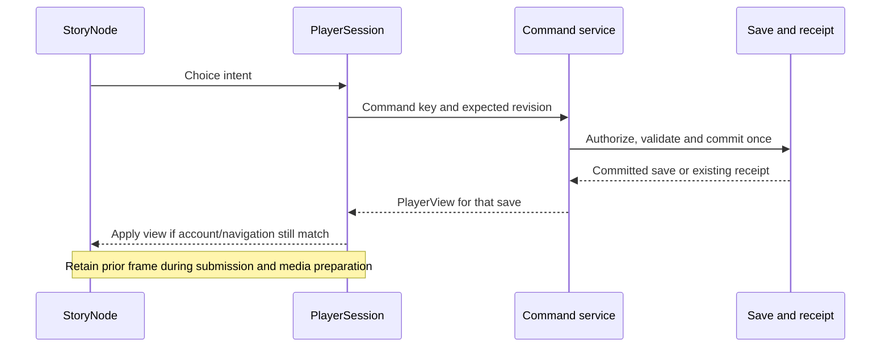

# Story player runtime

Status: implemented in the working branch; verification below. This change implements the player runtime first, as requested. It preserves the existing edition/save format and gameplay rules. StoryTrunk editing, selective unfinished-branch suppression, generalized rewards and new node types remain deferred.

## Ownership and authority

The application shell owns navigation and authentication. A dedicated player session owns loading, command submission, reconciliation and the last authoritative view. The shared provider exposes `useStoryContext()` for pinned identity, `usePlayerContext()` for the active run projection and `useUserContext()` for the explicit account projection. These are logical views of one composed context, not new persisted records. The shared Story provider composes them for the shared StoryNode lifecycle. Preview adapts authored data into the same rendering contract in a disposable context.

Renderers receive presentation and server-evaluated output availability. They do not need destination IDs, conditions, effects, quiz scoring rules or the rest of the graph. They emit choice intent only. Authority remains in the portable rules and authenticated transaction service.

## Transitions

A client negotiating `X-Story-Player: player-view-v1` receives `{player: PlayerView}` from a successful command and `PlayerView` from the run GET. A successful command returns the committed player view in the same HTTP response. The client applies that view without a second player GET for in-run transitions. Starting a different run navigates into a fresh session and loads it once. Unknown outcomes retain the exact command key and payload for retry; stale revisions require reconciliation. Responses belonging to another account, navigation or newer request cannot replace the active view. Pending dice remains on its node until a separate Next command.

Keep the current player frame while submitting and preparing media. Immediate control feedback acknowledges intent without predicting a destination or outcome. Failed media has the existing transcript/retry recovery. Starting or returning to another run replaces the session rather than mixing state.

## Caching and disclosure

The edition cache is a process-local LRU of at most 32 entries with a 60-second TTL. Its key includes the edition path and precise manifest update timestamp; the manifest readiness check still runs on every access. Only complete validated immutable definitions are inserted. Never cache player state, authorization or mutable publication pointers as edition data. Failed/partial edition loads are not cached. Cached objects cannot be mutated by a caller. Each request still validates identity and access; commands still validate the current run revision.

Anything sent to the browser is inspectable. Speculative media is a disclosure decision, not a security boundary. Keep preloading bounded to an explicitly permitted deterministic next asset, respect data-saving preferences and invalidate obsolete preparation. The new representation omits routes, effects, condition expressions, scoring mappings and private score totals. Hidden options are omitted; visible options carry server-evaluated condition/item-cost availability. Player APIs now require the new contract, save lists/history are projected, and raw run/receipt reads are denied by the matching Firestore rules. Deploy both API and rules to enforce this boundary; narrative text, visited history and permitted next-media hints remain inspectable. Browser readiness is distinct from API completion; preloading cannot commit progress.

## Verification and compatibility

Require the versioned rendering contract for player endpoints; older player clients must reload/update. Preserve existing stored data and receipt semantics. Old receipts remain replayable without reexecuting actions or rewriting editions. Verification covers response projection, same-key retry, stale/concurrent actions, pending dice, account/navigation races, cache isolation/eviction/expiry and desktop/mobile frame retention. The browser transition check counts requests and records click-to-playing time; the local request/presentation diagnostics below provide the next layer; centralized production aggregation remains future work. No production latency promise follows from local timing alone.

## Owned inventory and item history (S29)

PlayerView adds an optional `inventory` array of positive owned quantities with item ID, name and description. The server selects metadata from the run's pinned edition; uncatalogued IDs use the ID as name and an empty description. Never send the full catalogue or definitions for zero/unowned items. Older responses without this field can render raw IDs from the existing quantities. No new gameplay authority or cross-run inventory is introduced.

New committed run events carry optional `itemChanges`, each with item ID, pinned display metadata and a signed nonzero net quantity delta. Compare authoritative inventory before and after the entire command, including costs, route effects and entry effects. Root and child starts compare against empty inventory, never the parent's inventory. These are net gains/losses, not a breakdown of individual spending and rewards; equal spending and grants have no net entry. Display this meaning explicitly. Store the display snapshot with the event atomically with save/receipt so later reads need no mutable catalogue lookup. Exact retries create no additional event. Old events remain readable without invented history or backfill.

The inventory is a read-only modal drawer inside the Story provider, with Escape, focus containment/restoration and an empty state. It overlays playback without changing player geometry. Current inventory follows accepted server views; the Story log retains past changes even after an item reaches zero. Neither surface reveals future item definitions, routing, conditions or account-key evidence.

## Visible option costs (S30)

Visible outputs may include optional `itemCosts`: item ID, edition-pinned name (raw-ID fallback), aggregated required quantity and current owned quantity. Omit zero-total costs and all costs of hidden outputs. A visible cost intentionally reveals its item name even when unowned; descriptions, future rewards, condition expressions and destinations remain private. This is a narrow extension of S29, not a catalogue projection.

The shared StoryNode controls show `Costs N Name · You have M` and an insufficient-inventory message when any displayed requirement exceeds ownership. Enough inventory does not imply eligibility: the server's `enabled` remains authoritative for other conditions. Commands still submit only intent and revalidate costs in the transaction. Quantities include duplicate cost rows summed exactly as affordability checks do (up to 20 × 999); older responses without itemCosts retain existing rendering. Studio uses the same projection with its disposable inventory and draft catalogue. No save/edition migration, new item action or reward disclosure is introduced.

## Implementation map

- Portable presentation contract: packages/contracts/player.ts; pure projection: packages/domain/player.ts.
- PlayerSession owns request sequence, submission lock, exact uncertain retry, stale state and authoritative view. main.tsx owns navigation, authentication and shell errors.
- services/api/player-view.ts builds media and context projections for GET and command responses. Projection failure after commit returns a retryable error; replay uses the receipt save rather than reapplying the command.
- The cached edition is cloned on insertion/read. User projections, saves and mutable catalogue pointers are never cached here.
- StoryNode adapts Studio input locally; published renderers consume evaluated outputs without evaluating server routes. ScenePlayer retains the existing element/frame while loading media. Preloading remains one deterministic, unconditional, cost-free next clip and is skipped for Save-Data.



Reading set: root/scoped AGENTS, CONTRIBUTING, documentation workflow, current StoryNode contract, architecture, StoryNodes, rendering/types, Story/Player/User contexts, storage, keys and decisions S04/S05/S07/S08.


## Documentation-impact review and verification

- Documentation reviewed: root/scoped AGENTS, CONTRIBUTING, development workflow, Story index, terminology, architecture, StoryNodes, node types/rendering, Story/Player/User contexts, keys and data/storage; current contract and design system. Preserve server authority, immutable editions, version-pinned saves, isolated child runs and separate Dice Roll/Next.
- Contract impact: new versioned presentation projection, shared session controller and edition cache; index, component guide, rendering/current contract and decisions updated together. Persisted editions, saves and command receipts are unchanged.
- Current/target gap: trunk authoring, conditional unfinished-path suppression, general typed output bindings, durable visit identities, cross-story imports and rewards remain deferred. The subsequent disclosure-boundary change below retires old player responses while preserving stored data.
- Verification: TypeScript, 105 unit tests and production build passed. All 39 emulator integration tests passed, including old receipt negotiation, exact replay and projected Dice Roll/reload/Next. The build retains its existing large-chunk warning.
- Browser verification: delayed transitions at 1440/390 pixels used one POST and zero follow-up run GETs, retained the video element and stable geometry. Local click-to-playing was 2024/2048 ms with injected 800 ms command and 800 ms media delays; these are not production benchmarks. Mixed StoryNodes/dice reload, shared video previews, desktop/mobile quiz results/reload plus Studio quiz scoring/preview, and the full seven-width player suite passed, including child runs, retry/stale/offline and endings. The mobile dice screenshot was inspected.
- Studio follow-up: the browser fixture now supplies the server-derived `writingHelp` capability instead of assuming the Copilot feature alone enables Studio writing. The complete desktop/mobile Studio suite passed: create/autosave/reload, shared preview, publication and authoritative play, Storage clips, AI suggestion accept/discard/undo and image generation. TypeScript passed after this fixture-only correction. Read the AI-authoring boundary, Creator Studio AI help and Copilot access contract for this follow-up; production capability logic is unchanged.
- Verification limits: hosted authentication, real-device Safari and production latency remain unverified.
- Reviewer: self-review against the above contracts; independent review pending. Commit and push authorized by the user; no deployment or migration performed.

## Transition diagnostics

Browser-local diagnostics now provide bounded transition measurements: request start through parsed response (including token acquisition/network/server/JSON), then response through presentation readiness. Video uses the first submitted video frame where supported, with a separately labeled playing-event fallback. Reading content uses two animation frames as a paint opportunity, not a guarantee that images have downloaded. Autoplay blocks, media errors, stale requests, cancellation and timeout are separate outcomes. Diagnostics must never alter progress, retries, media control or layout. Samples contain durations and categories only, never run/account IDs, commands, text, URLs or routes, and are not transmitted to analytics. Navigation and hidden tabs cancel measurements.


Inspect a deployed build locally in browser DevTools after playing:

```js
console.table(window.storybranchTransitionTimings());
```

The buffer retains the last 50 completed attempts in memory and resets on reload. It does not send telemetry or use persistent browser storage. Entries include a local attempt counter, load/command category, StoryNode type, outcome and three millisecond durations:

| Field | Meaning |
| --- | --- |
| requestMs | Start of the accepted session operation through the parsed response; includes token acquisition, network, server work and JSON parsing. Null when no response was accepted. |
| presentationMs | Accepted response through presentation readiness or a labeled non-success outcome. Includes React work and media preparation, not only network download. |
| totalMs | Whole attempt through its recorded outcome. Rounded durations may differ by 1 ms when summed. |

Use successful command outcomes for transition comparisons. `video-frame` means the browser submitted a frame via requestVideoFrameCallback; `playing-fallback` means only the playing event was available. `content-paint` is two animation frames after the reading view committed (a paint opportunity, not proof all images loaded). `retained-view` identifies a response for an already-presented revision. Do not combine those categories blindly.

Autoplay-blocked, media-error, request-error, stale, cancelled and timeout remain separate outcomes. A 30-second diagnostic timeout does **not** abort a request or commit progress. Superseded operations, navigation and hidden tabs cancel measurement; hidden-tab starts are excluded. Stale callbacks cannot complete a newer attempt. Only one pending attempt and one internal readiness identity are retained; neither identity is exported. Previews use the shared lifecycle but do not start session measurements.

### Transition-diagnostics review

Documentation reviewed: root/scoped AGENTS, CONTRIBUTING, workflow, Story index and terminology, current contract, runtime, rendering and type contracts, and the prior context/architecture reading set. Contract impact: browser-local observability only; request, save, routing and prefetch policies are unchanged. Current/target gap: production aggregation and real-device/hosted measurements remain future work. Reviewer: self-review; independent review pending. Verification: TypeScript, 109 unit tests and production build passed (existing bundle-size warning remains). Targeted timing/session tests passed again after guarding hidden-tab readiness callbacks. Emulator-backed browser checks passed for desktop/mobile video-frame timing, a simulated browser without frame callbacks, reading/dice timing and Dice Roll/reload/Next. The delayed transition still makes one POST and zero follow-up GETs, preserves video geometry and reuses its element. Injected 800 ms command/media delays appeared in their respective phases (about 900 ms request and 845 ms presentation locally); these verify attribution, not production speed. Backend rules/contracts were unchanged, so the prior 39 integration tests were not rerun in this diagnostics-only change. Real-device Safari and hosted measurements remain unverified.

## Player disclosure boundary

The user authorized retiring older player responses on October 25, 2026. All authenticated `/api/playthroughs` routes require `X-Story-Player: player-view-v1`, including save lists and history. Missing/unsupported versions return a validation error with a reload instruction before any command runs. The header selects a contract, never grants authority. Stored legacy names, immutable editions and existing full-save receipts remain readable only inside the service; retries return freshly projected views without reexecuting outcomes. Non-player authoring/library naming compatibility is unchanged.

Save lists use the allowlisted PlayerRun projection. History uses an allowlisted event projection, preserving visited outcomes and roll results but not command IDs or arbitrary internal fields. Direct Firestore reads of run subtrees and receipts are denied even to their owner; the authenticated API is the read boundary. Deployment must include these rules before claiming the disclosure boundary is enforced. Existing deterministic next-media preloading and authored narrative clues remain inspectable; this is not cryptographic spoiler prevention.

### Disclosure-boundary review and rollout

Documentation reviewed: root/scoped AGENTS, CONTRIBUTING/workflow, Story architecture, runtime/rendering/type contracts, Player/User contexts, data/storage, keys, naming compatibility, shared Firebase setup and AI-authoring/Copilot access boundaries. Contract impact: user-authorized retirement of old player responses, event/roll projections, central API-client negotiation and stricter Firestore reads. Non-player APIs, editions, persisted saves and internal receipts retain their contracts. No new gameplay types or authoring behavior.

Verification: TypeScript, 110 unit tests and production build passed; 40 emulator integration tests passed. Checks cover unsupported/missing contracts before mutation/replay, response allowlists, stored-score preservation, legacy names/receipts, malformed stored-data service errors, and owner/cross-user database denial. Full seven-width player flow, desktop/mobile dice persistence and quiz results/reload plus Studio quiz preview passed. Existing bundle warning remains. Reviewer: self-review; independent review pending.

Rollout: deploy the updated frontend and API, and deploy `firebase/firestore.rules` to the same project. Earlier cached player bundles must reload; update errors explicitly say so. No database migration, edition rewrite, data deletion or production deployment was performed here. Previously delivered responses/assets cannot be recalled. Public catalogue metadata, authored narrative clues, visited history, permitted deterministic preload assets, explicitly shared library content and authorized creator/admin views are outside the hidden-routing guarantee. Hosted verification and real-device Safari remain outstanding.

S33 conditions consume the current entry snapshot on the server. Missing optional inputs evaluate false at the leaf comparison; Not composes normally. No snapshot values, bindings or condition expressions are added to player projections. The preview inspector is creator-only and disposable. See [S33](branch-data.md#s33--visual-bindings-and-current-entry-input-conditions).

S35f adds a typed battle presentation to the shared player view and advertises the battle capability from the API client. Marked run GETs and commands now use the full projection/media composition. The StoryNode wrapper owns battle actions; the child Battle renderer shows persisted health, turns and results in reserved space. Existing offline, uncertain retry and stale-tab recovery remain authoritative. Old partial staged receipts reconcile via a fresh GET without repeating their action. Public starts, Studio and publication are still gated; community side-Story offers for marked editions are suppressed pending integration. See [battle rendering](battle.md#s35f-shared-player-rendering-boundary).

S35g extends the existing start/import-consent flow to explicitly marked editions. The client advertises battle capability on root import offers and source-run lists as well as playthrough calls. Starting/replaying receives the full shared player view; each new run has fresh encounter identity and independently resolved progress/import snapshots. Marked community child entry and offers remain gated. See [root starts](battle.md#s35g-root-start-and-replay-boundary).
