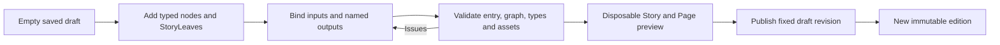

# StoryNodes, graphs and authoring

Status: target contract. Decisions: S01–S03, S06–S08. The current wire format is `Story.pages` / `StoryPage` / `targetPageId`; see [current behavior](../16-story-pages.md). **StoryNode is the conceptual graph placement, not a request to revive `targetNodeId` or rename code in this documentation change.**

## Consistent structure

Every type declares **typed input → interaction/state → completion event → typed result → named output → destination**. Node configuration is creator-authored; resolved input is server-derived; result is server-validated. They are separate schemas even when their fields look alike.

The following is a design sketch, not an accepted payload or a new exported TypeScript API. Symbolic field types describe contracts that must be implemented and bounded before use.

```ts
type NodeDefinition<C, I, A, S, R> = {
  typeId: string;
  typeVersion: number;
  configSchema: Schema<C>;
  inputSchema: Schema<I>;
  intentSchema: Schema<A>;
  stateSchema: Schema<S>;
  resultSchema: Schema<R>;
  outputSlots: readonly OutputSlot[];
  completionPolicy: CompletionPolicy;
};

type NodePlacement<C> = {
  id: PlacementId;
  typeId: string;
  typeVersion: number;
  title: string;
  config: C;
  sourceContent?: { id: ContentId; revision: number };
  inputBindings: Record<InputName, Binding>;
  entryEffects: readonly Effect[];
  outputs: readonly {
    id: OutputId;
    label: string;
    order: number;
    destination: { kind: "node"; nodeId: PlacementId };
    effects: readonly Effect[];
  }[];
};
```

`Schema`, `Binding`, `CompletionPolicy` and IDs above are explanatory types. The actual format should use a discriminated union mapped from registered type IDs, so Video config cannot silently accept Battle fields. Each schema rejects extra fields, non-finite numbers, unsupported versions, excessive lists/nesting and arbitrary executable expressions. A published edition pins the schema/rules/type versions needed to replay its meaning.

Bindings are allowlisted references to authored constants, declared run variables, validated import snapshots or a compatible predecessor result. They are never arbitrary object paths or expressions evaluated by the browser. The service resolves and validates them on entry. A node with several predecessors must accept every possible incoming result, provide a declared default, or require a validated edge mapping; one compatible predecessor is insufficient.

## Outputs, branches and values

Use stable semantic output IDs such as `next`, `surrender`, `risk`, `fail`, `pass`, `win` and `loss`. The editor may display branch **0, 1, 2, 3**, but reordering display positions must not change saved routes. A branch number is not a destination ID or a trusted incoming value. Every output binds exactly one destination placement in the same edition. Many outputs may share a destination.

A DiceRoll can produce `{ value: 14, sides: 20, threshold: 16, passed: false }` and select output `fail` (display branch 0). It does not send the number 0 as an untyped substitute for the roll. The next node may receive a bounded typed projection of that persisted result. Carrying a result forward requires an explicit binding; a later node does not get unrestricted access to all prior node state.

Current dice keeps `lastRoll`; arbitrary typed edge payloads and persistent visit histories are future work. New output IDs and result bindings must map to current commands only where the semantics actually match, with a versioned format change where needed.

Conditions decide availability or a server-selected output. Costs and effects are declared and validated, not embedded in render callbacks. Entry-effect frequency must be explicit: once per run, per visit or a separately defined cadence. Account rewards have their own non-repeatable claim rules. Changing frequency changes ruleset semantics; do not reinterpret existing `appliedEntryEffects` markers.

## Blank drafts and publication

New Story defaults to no nodes and no entry selection. Templates such as a quiz or comic are explicit creator choices. An empty draft can be saved, reopened, titled and edited. It cannot be published or played as a completed story. Draft schemas must permit incomplete wiring and report issues without pretending they are valid publication schemas.

Studio should let a creator add a registered type, edit its config, bind its inputs and outputs, mark a start, create StoryLeaves, and preview supported paths. Route changes do not alter content-library revisions. Canvas position does not determine order. Deleting a connected node must surface affected references; it cannot silently reroute them to an arbitrary ending.



## StoryLeaves and termination

A StoryLeaf is an explicit endpoint in the graph, with `story` or `branch` completion intent and optional ending presentation. Its input may include a typed ending summary; entering it through a committed transition completes the run exactly once. It has no authored in-story outputs. Replay, return to parent and discovery are common shell actions that start/resume other contexts. Completion closes the current run; the server derives permitted return behavior from that run's validated parent reference. Creators and clients cannot supply an arbitrary parent destination. A root run cannot complete with a branch-return disposition that has no parent.

An ending video may be the presentation of a leaf, or a Video node may lead to a separate leaf. Watching the leaf's presentation is not proof of a new reward; completion is the committed entry. Current `kind: "ending"` models leaf semantics on eligible page types. The target does not require an extra blank screen after every ending.

**Every branch must be able to reach a StoryLeaf.** Publication validation must check:

1. One valid entry; unique placement/output IDs; only registered type versions; all published nodes reachable from the entry.
2. Every declared output is bound; every destination exists in this edition; every input mapping is compatible; all possible outcomes (including cancel/error where meaningful) are represented.
3. Starting from all leaves, reverse traversal reaches every node. At least one reachable leaf is necessary but insufficient.
4. For every legal reachable run state, a non-leaf has an available continuation or a declared recovery path. All-locked options require a usable fallback, such as Leave → leaf. Static topology alone cannot prove this; use bounded condition analysis and state-based tests, and reject unresolved unsafe publications.
5. Detect strongly connected components. Interactive loops require a guaranteed usable exit, with no repeatable account reward exploit. Automatic loops require a finite visit limit and deterministic exhaustion route to a leaf. Within-node battle turns have their own bounded/escape policy.

The guarantee is that a player can finish, not that a person repeatedly choosing a voluntary loop must eventually stop. Unsupported or unprovable automatic cycles are publication errors. Network/media failures preserve the visit and offer retry or exit controls without fabricating a narrative victory; see [StoryPage](story-page.md).

Current publication already checks unreachable nodes and structural paths to endings. Conditional trap analysis, automatic-cycle bounds, typed edge bindings and genuinely empty-draft UX remain gaps.

## Adding a type

Before implementation, update [the type catalogue](page-types.md) and the required table in [docs/16](../16-story-pages.md). Specify input/config/state/result schemas, intents, completion, output IDs, required/fallback routes, authority, limits, reload/retry behavior and preview behavior. Then implement the registered contracts, pure rules, service persistence, shared Page renderer and Studio editor together. Include domain routing checks, server authority/idempotency tests and a browser flow with reload through the shared wrapper. Unsupported types must fail clearly; never use an implicit video fallback.
