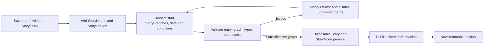

# StoryNodes, graphs and authoring

Status: target contract. Decisions: S01–S03, S06–S08. The current wire format is `Story.storyNodes` / `StoryNode` / `targetStoryNodeId`; see [current behavior](../16-story-nodes.md). **The naming change preserves current behavior; it does not revive the retired prototype format or implement the future graph features below.**

## StoryTrunk, StoryNodes, StoryBranches and StoryLeaves

Use [the canonical glossary](terminology.md). Each Story has exactly one StoryTrunk: the title/configuration root and default authoring starting point, outside the playthrough. It configures Story details and StoryContext definitions; its start connection leads into the playable graph. Every player-visible StoryNode connects to the StoryTrunk, other StoryNodes and/or StoryLeaves, and can have multiple outgoing StoryBranches. Drafts may contain disconnected work, with creator-facing diagnostics.

Each StoryBranch is a directed connection from the StoryTrunk or a StoryNode to a StoryNode or StoryLeaf. It can carry typed data mappings and availability conditions. Paths may diverge and reconverge at StoryNodes. Following a branch within the playthrough keeps the current Story edition and PlayerContext. Starting a separately authored community side Story is a different operation with an isolated child run. These target capabilities remain future work; the [naming compatibility](naming-compatibility.md) change renames existing fields without adding their behavior.

## Consistent structure

Every type declares **typed input → interaction/state → completion event → typed result → named output → destination**. Node configuration is creator-authored; resolved input is server-derived; result is server-validated. They are separate schemas even when their fields look alike.

The following is a design sketch, not an accepted payload or a new exported TypeScript API. Symbolic field types describe contracts that must be implemented and bounded before use.

```ts
type StoryNodeDefinition<C, I, A, S, R> = {
  typeId: string;
  typeVersion: number;
  configSchema: Schema<C>;
  inputSchema: Schema<I>;
  intentSchema: Schema<A>;
  stateSchema: Schema<S>;
  resultSchema: Schema<R>;
  outputSlots: readonly OutputSlot[];
  completionPolicy: CompletionPolicy;
};

type StoryBranch = {
  id: OutputId; // Stable within the source; source ID + output ID identifies the edge
  label: string;
  order: number;
  destination: { placementId: PlacementId }; // StoryNode or StoryLeaf
  inputBindings: Record<InputName, Binding>;
  availableWhen?: Condition;
  effects: readonly Effect[];
};

type StoryNodePlacement<C> = {
  id: PlacementId;
  typeId: string;
  typeVersion: number;
  title: string;
  config: C;
  sourceContent?: { id: ContentId; revision: number };
  inputBindings: Record<InputName, Binding>;
  entryEffects: readonly Effect[];
  outputs: readonly StoryBranch[];
};
```

`Schema`, `Binding`, `Condition`, `CompletionPolicy` and IDs above are explanatory types. The actual format should use a discriminated union mapped from registered type IDs, so Video config cannot silently accept Battle fields. Each schema rejects extra fields, non-finite numbers, unsupported versions, excessive lists/nesting and arbitrary executable expressions. A published edition pins the schema/rules/type versions needed to replay its meaning. StoryTrunk has a separate metadata/configuration contract and start connection; it does not register a playable renderer. StoryLeaf has a separate endpoint/reward role, even when its presentation reuses a renderer.

Bindings are allowlisted references to authored constants, declared run variables, validated import snapshots or a compatible predecessor result. They are never arbitrary object paths or expressions evaluated by the browser. Placement input bindings provide defaults; the selected StoryBranch may supply declared inputs instead. Each input must resolve to exactly one source under an explicit, schema-checked override rule. The service resolves and validates them on entry. A node with several predecessors must accept every possible incoming result, provide a declared default, or require a validated edge mapping; one compatible predecessor is insufficient.

## Outputs, StoryBranches and values

Use stable semantic output IDs such as `start`, `next`, `surrender`, `risk`, `fail`, `pass`, `win` and `loss`. Each enabled output binds a StoryBranch to exactly one destination placement in the same edition. The editor may display branch **0, 1, 2, 3**, but reordering display positions must not change saved routes. A branch number is not a destination ID or a trusted incoming value. Many StoryBranches may share a destination StoryNode or StoryLeaf. A linear StoryNode has one continuation; choice/outcome StoryNodes may have several. StoryLeaves have no outgoing in-story branches. Returning to the StoryTrunk title view is shell navigation outside the playthrough, not a completion route.

A DiceRoll can produce `{ value: 14, sides: 20, threshold: 16, passed: false }` and select output `fail` (display branch 0). It does not send the number 0 as an untyped substitute for the roll. The next node may receive a bounded typed projection of that persisted result. Carrying a result forward requires an explicit binding; a later node does not get unrestricted access to all prior node state.

Current dice keeps `lastRoll`; arbitrary typed edge payloads and persistent visit histories are future work. New output IDs and result bindings must map to current commands only where the semantics actually match, with a versioned format change where needed.

Conditions decide availability or a server-selected output. Costs and effects are declared and validated, not embedded in render callbacks. Entry-effect frequency must be explicit: once per run, per visit or a separately defined cadence. Account rewards have their own non-repeatable claim rules. Changing frequency changes ruleset semantics; do not reinterpret existing `appliedEntryEffects` markers.

## Blank drafts and publication

New Story creates exactly one StoryTrunk with editable title/configuration and no StoryNodes, StoryLeaves or connected StoryBranches. This is the blank Story. Templates such as a quiz or comic are explicit creator choices. The draft can be saved, reopened, titled and edited. It cannot start a playthrough or publish a playable edition until a valid start connection and path to a StoryLeaf exist. Draft schemas permit incomplete wiring and report issues separately from the validated playable graph.

Studio should open on the unique StoryTrunk, where the creator sets Story details and context definitions. The creator can add registered StoryNode types, edit configs, connect the trunk's start, bind data and conditions on StoryBranches, configure StoryLeaf rewards, and preview supported paths. A dedicated trunk schema is future work; current `entryStoryNodeId` remains the first playable placement. Route changes do not alter content-library revisions. Canvas position does not determine order. Deleting a connected StoryNode must surface affected references and disable unfinished paths; it cannot silently reroute them to an arbitrary ending.



## StoryLeaves and termination

A StoryLeaf is an explicit endpoint in the graph, with completion intent for the current Story run, optional ending presentation and configurable end-of-path rewards. Its input may include a typed ending summary; entering it through a committed transition completes the run exactly once. Local rewards use declared effects; account rewards require approved reward/issuer references and durable claim deduplication. Retrying, reopening the leaf, returning to the title or replaying cannot bypass the reward's declared claim scope. See [keys](keys.md) for grant authority. A creator cannot mint premium rights through leaf configuration.

A StoryLeaf has no outgoing in-story StoryBranches. Replay, return to parent and discovery are common shell actions that start/resume other contexts. If this is an isolated child Story, the server derives permitted return behavior from that run's validated parent reference. Creators and clients cannot supply an arbitrary parent destination. A root run cannot return to a parent it does not have. Rejoining another StoryNode through an ordinary StoryBranch does not complete the run.

An ending video may be the presentation of a leaf, or a Video node may lead to a separate leaf. Watching the leaf's presentation is not proof of a new reward; completion is the committed entry. Current `kind: "ending"` models leaf semantics on eligible StoryNode types. The target does not require an extra blank screen after every ending.

**Every enabled StoryBranch must eventually lead to a StoryLeaf.** Validate the authored graph and derive a safe effective graph for preview/publication:

1. Exactly one StoryTrunk and a valid start connection; unique placement IDs and output IDs within each source; only registered type versions. Every playable placement is reachable from the start; the trunk itself is outside gameplay visits.
2. Every enabled output is bound to an existing destination in this edition with compatible input mappings. Required outcomes (including cancel/error where meaningful) must remain safe. Optional authored choices may be suppressed when unfinished.
3. Starting from all StoryLeaves, reverse traversal identifies connections with no path to a leaf. Disable those StoryBranches and hide their options from players; preserve them in drafts and notify the creator with source, output, affected path and reason. At least one reachable leaf is necessary but insufficient.
4. Revalidate after suppression, propagating invalidity upstream until stable. A DiceRoll missing a safe pass or fail destination cannot remain playable; disable incoming branches to it. Likewise, suppress entry into a choice node left with no usable continuation. Remove unreachable placements from the effective player graph, while retaining draft work. If no safe start survives, block play/publication and explain why.
5. For every legal reachable run state, a non-leaf has an available continuation or a declared recovery path. All-locked options require a usable fallback, such as Leave → leaf. Static topology alone cannot prove this; use bounded condition analysis and state-based tests. Unresolved unsafe paths must be disabled; they cannot be made safe by showing a locked option.
6. Detect strongly connected components. Interactive loops require a guaranteed usable exit, with no repeatable account reward exploit. Automatic loops require a finite visit limit and deterministic exhaustion route to a leaf. Within-node battle turns have their own bounded/escape policy.

Creator diagnostics are visible in Studio, including which StoryBranches and options will be omitted. Players cannot see or select an unfinished branch; the command service rejects forged or stale attempts to invoke it. A false condition on an otherwise valid branch may use an explicit locked/hidden policy, but it cannot authorize an unfinished path. Required random outcomes cannot simply be filtered after a roll: that would bias the result.

The guarantee is that a player can finish, not that a person repeatedly choosing a voluntary loop must eventually stop. Unsupported or unprovable automatic cycles cannot enter the playable graph. The validated effective graph and its derivation are pinned at publication; repairing a draft creates a new edition, never changes an existing save's routes. Network/media failures preserve the visit and offer retry or exit controls without fabricating a narrative victory; see [StoryNode rendering](node-rendering.md).

Current publication rejects unreachable nodes and missing structural paths to endings. Selective disabling/hiding with upstream propagation, the dedicated StoryTrunk, conditional trap analysis, automatic-cycle bounds, typed branch bindings and blank-trunk authoring UX are target work. This PR documents them and renames existing concepts; it does not change current graph validation behavior.

## Adding a type

Before implementation, update [the type catalogue](node-types.md) and the required table in [docs/16](../16-story-nodes.md). Specify input/config/state/result schemas, intents, completion, output IDs, required/fallback routes, authority, limits, reload/retry behavior and preview behavior. Then implement the registered contracts, pure rules, service persistence, shared StoryNode renderer and Studio editor together. Include domain routing checks, server authority/idempotency tests and a browser flow with reload through the shared wrapper. Unsupported types must fail clearly; never use an implicit video fallback.
