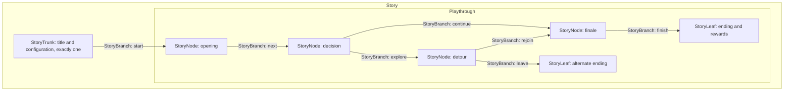

# Story terminology

Status: canonical vocabulary for Story documentation and future design, incorporating the user's explicit definitions. This glossary owns the meanings of **Story**, **StoryTrunk**, **StoryNode**, **StoryLeaf** and **StoryBranch**; other documents link here. These are target contracts where current code differs.

## Terms and relationships

| Term | Meaning | Relationship |
| --- | --- | --- |
| **Story** | The complete creator-owned work, with identity, drafts and immutable published editions of its graph. | Contains its StoryTrunk, StoryNodes, StoryBranches and StoryLeaves. |
| **StoryTrunk** | The single core/root of a Story: its title/configuration surface and the place to configure Story details and StoryContext definitions. | Exactly one per Story, created with it and selected by default in authoring. It is the starting root, outside the playthrough; its start connection leads into playable content. |
| **StoryNode** | A connected unit of content or interaction, such as Text, Video, ComicStrip, DiceRoll or TurnBasedBattle, with typed inputs and outputs. | Every published StoryNode connects to the StoryTrunk, other StoryNodes and/or StoryLeaves. It may have several outgoing StoryBranches. |
| **StoryBranch** | A directed connection linking the StoryTrunk, StoryNodes and StoryLeaves. It may carry explicitly mapped typed data and gate access through conditions. | Starts at the StoryTrunk or a StoryNode and targets a StoryNode or StoryLeaf. A StoryNode may expose several StoryBranches. A sequence of connections forms a path. |
| **StoryLeaf** | An intentional endpoint of a Story path, with configurable ending presentation, end-of-path rewards and completion effects. | Completes the current Story run; no outgoing in-story StoryBranches. Rewards are validated and committed by the server. The completion interface offers replay, discovery and return to a parent for an isolated child Story. |

Lowercase story, trunk, node, branch and leaf may be used as shorthand after their scope is established. Use the full names in definitions, diagrams, architecture contracts and new conceptual type names. Use these names in the code and UI as well as in architecture prose.

The StoryTrunk is not a route through the graph or a playable StoryNode type. It owns authoring details such as title, cover, synopsis and StoryContext configuration. The runtime reads those definitions from the pinned edition. Mutable run state remains in PlayerContext; account facts remain in UserContext. Opening the title/configuration view does not enter a gameplay visit or award completion rewards. Returning to the title is shell navigation, not a substitute for reaching a StoryLeaf.

## Connectivity

Every player-visible StoryNode must connect into the graph reachable from the StoryTrunk's start connection. Every enabled StoryBranch must eventually lead to a StoryLeaf under the [termination rules](story-nodes.md#storyleaves-and-termination). If a StoryBranch cannot reach a StoryLeaf, notify the creator, disable the branch and hide its associated option from the player. Server commands must also reject it; hiding a button alone is insufficient. Incomplete work stays in the draft. Valid remaining paths may be exposed only after the effective playable graph passes validation; if no valid start remains, starting/publishing a playable edition is blocked.

A StoryNode can have one continuation or several choices/outcomes; linear content still uses an explicit StoryBranch. An ordinary condition that is false is different from an unfinished path: an otherwise valid gated option may be shown locked under an explicit presentation policy, whereas an unfinished path is always disabled and invisible to players. Validation must propagate unsafe required outcomes upstream; a DiceRoll cannot expose Roll when a possible result has no safe destination.

This is a directed graph, not a strict tree: StoryBranches can reconverge, and permitted loops follow the existing exit/bounding rules. A connection alone does not establish a new Story, transfer context, or grant state authority.

## Different meanings of branch

| Phrase | Meaning and state boundary |
| --- | --- |
| StoryBranch | An in-story graph route. Following it stays in the same pinned edition and PlayerContext. |
| Community side Story / isolated child Story | A separately authored Story launched through an authorized branch location. It gets a separate pinned edition/run/context and can return to its parent; state is not automatically merged. |
| Existing community branch record | Current implementation terminology for linking a community side Story to a source location/version. Its `branchId` is not the ID of every StoryBranch in the graph. |
| Git branch | A source-control reference, unrelated to the narrative model. |

Use “community side Story” or “child Story” when describing the separate-context experience. Keep “community branch” when identifying an existing product label, API or record, and qualify it. Do not infer that every choice creates a child save or that a StoryBranch by itself closes a run.

## Mapping to the current implementation

The code, UI, files and new stored/API contracts use the canonical names. The [compatibility boundary](naming-compatibility.md) reads prior records and serves old clients without changing gameplay or rewriting immutable editions.

| Canonical concept | Existing implementation vocabulary |
| --- | --- |
| Story and its edition | `Story`, `Story.storyNodes`, `versionId`, `entryStoryNodeId` |
| StoryTrunk | Story metadata/title surfaces partially cover its purpose; no dedicated trunk record/schema exists. `entryStoryNodeId` currently identifies the first playable placement, not the title/configuration root. A future trunk schema must preserve that distinction. |
| StoryNode | A placement currently represented by `StoryNode`, `storyNodeSchema`, `storyNodeType`, `storyNodeId`; rendered inside the shared `Story` provider and `StoryNode` component |
| StoryBranch | A logical output route; current `choices` and their `outcome` route bindings, including dice success/failure and reveal results. One choice can resolve to several possible branches. |
| StoryLeaf | Eligible placement with `kind: "ending"`; completion shell supplies exits outside the story graph. Generalized leaf reward configuration remains target work. |
| Reusable content | Current StoryNode library and `StoryNodeContent`; content becomes a StoryNode placement only when bound into a Story |

The portable `StoryNode` data type and shared `StoryNode` component describe data and rendering respectively; they do not create two graph entities. In target architecture prose use **StoryNode type**, **StoryNode rendering**, **StoryBranch routing** and **StoryLeaf completion**. File paths such as `docs/16-story-nodes.md` remain stable implementation references. The retired prototype schema remains retired regardless of the conceptual terminology.
