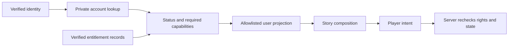

# UserContext: account ownership and projection

Status: target design. Decisions S04, S06, S09. Read [keys](keys.md) for entitlements and imports. UserContext owns account-wide facts; PlayerContext owns the active run. One UID is the initial account identity; multiple personas are not assumed.

## Private account and safe projections

| Data | Owner/source | What Story code may see |
| --- | --- | --- |
| Authentication | Auth adapter/provider | Stable actor ID; credentials/tokens remain outside portable contracts |
| Display preferences/profile | User through validated profile commands | Only needed display fields |
| Account stats/level | Authoritative progression service | Allowed stats snapshot at run start; later changes do not silently alter it |
| Achievement/export facts | Validated completion/reward service | Only declared, authorized facts with provenance |
| Save references | Owned runs | Bounded safe list or active-save reference; not full saves/history |
| Entitlements | Verified subscription/payment/promotion issuer | Narrow capability projection for UI; server rechecks authority |
| Wallet, billing and private audit | Dedicated service | No raw billing records or mutable balances in a story's context |
| Creator/admin feature flags | Account access policy | Relevant UI capabilities, never self-granting rights |

The current `StoryUser` is a small projection with identity, stats, achievements and save spots. It is not the full UserContext and must not become a raw Firebase user. Current `publish`, `generate` and `copilot` feature flags are administrative capabilities, not proof of a paid subscription. Approved account achievements use the private claim registry described below; generalized entitlements remain future work.

## Authorization flow

The client projection helps presentation but cannot authorize commands. Each service validates actor identity, ownership and current required permissions. Cross-user reads, claim IDs and save references are checked independently; possessing an ID is not permission.

## Global progress and key boundaries

S20 permits players to select their own completed source journeys for declared local-key imports. The picker returns only run ID, completion time and ending title after validating the destination and source contracts. No account-wide inventory query or creator-facing save access is introduced. The start transaction checks ownership again and snapshots the declared facts; source saves remain private and unchanged. See [selected-run imports](keys.md#selected-completed-run-imports-s20).

S19 permits a narrow exception to Story isolation: with player approval and explicit edition-pinned export/import declarations, Stories owned by the same creator may check permanent Story progress keys. Only declared boolean facts enter the destination's server-only snapshot, with provenance. The offer screen reads declarations rather than grants; creators and renderers receive no raw inventory. Cross-creator imports remain deferred; S20 below adds selected-run local facts. See [persistent-key imports](keys.md#persistent-key-imports-s19).

S18 invitation entry keys are private account grants under `storyEntryKeys`, scoped to starting exactly one Story. They are permanent after redemption; code deadlines and disabled status affect future redemptions only. The account receives only a minimal `invitationRequired/hasKey/canStart` projection through `/api/story-entry/{storyId}`. These keys do not enter generic StoryBranch conditions, authorize paid access or appear in another Story's user projection. See [the invitation contract](keys.md#invitation-entry-contract).

UserContext also owns per-player, per-Story progress across runs: completion counts and permanent narrative key grants. This is private to the account and the named Story, not shared StoryContext state or a platform achievement. The server resolves declared keys at run start and keeps the snapshot out of ordinary player payloads; only authorized branch results and newly earned completion labels are disclosed. See S17 in [keys](keys.md#shared-key-model-s17).

Approved account achievements are now stored as private durable claims, listed through `/api/achievements` and displayed in My adventures. Their grant authority is the separate [approval registry](keys.md#approved-account-achievements). Existing profile achievement strings are not claim evidence and are not populated from this registry; claims do not flow automatically into every Story's user projection. Only the current completion's achievement outcome is shown in that run. Account-achievement imports, public display consent and commercial rights remain deferred.

A story can award its namespaced local key through a validated effect. An approved export can create a persistent account fact, such as completion of a canonical chapter. A creator cannot grant platform XP, premium access, another creator's achievement, currency or a subscription merely by defining a key with that name.

Account facts require an issuer, namespace, source event/run, definition version, claim identity and revocation policy. Unique claim scope prevents farming across repeated runs; ordinary request receipts alone are insufficient because they expire. Eligibility and duplicate claims are checked atomically with the grant, or through a durable idempotent outbox when a separate service is involved.

Export availability is distinct from public profile display. A fact can be private to the user and authorized story checks. Other creators receive only declared boolean/value projections through the platform, never direct access to the user's historical saves. User sharing consent and cross-creator trust/namespace authorization must be specified before broad exports launch.

## Live changes and unavailable access

Narrative completion facts are stable snapshots unless explicitly revoked for integrity reasons. Subscriptions, paid access, bans and expiring promotional rights are live permissions, checked at start/resume and protected actions according to published policy. Expiry does not delete the user's saves or rewrite completed events. Provide a recoverable access explanation and catalogue/account navigation.

Refund/revocation behavior, offline access leases and whether an already-started paid story remains playable require product decisions before billing implementation. Never silently turn a one-time entitlement snapshot into permanent paid access.

## Checks

Verify minimal projections, no credentials in portable contracts, cross-user denial, rejected forged flags, idempotent unique claims, concurrent grants, expiry/revocation and continued preservation of owned saves. Do not assume the UI hiding a control is authorization.

S22 keeps achievement claims and awarded permanent Story keys distinct. An approved completion can grant a declared Story key, deduplicated per account/Story/key. Revocation marks the historical achievement according to its existing policy and stops new rewards, but does not erase narrative keys or saved snapshots. Existing claims alone do not trigger retroactive grants; see [binding policy](keys.md#achievement-bound-persistent-keys-s22).

S23 exposes a private earned-key history in Adventures through bounded Story progress and grant projections. Only the authenticated account can list its records. Labels, earned dates and source journey references are historical facts, not current access assertions. Unearned definitions, import snapshots, export permissions and internal approval IDs are excluded. See [key history](keys.md#earned-story-key-history-s23).

S24 adds `/api/story-entry-keys`, an account-only bounded history of redeemed invitation entry keys in Adventures. Its Story IDs, historical titles and redemption dates are separate from narrative rewards and reveal no invitation or issuer identifiers. Opening Story details retains normal publication and entry checks; see [invitation history](keys.md#private-invitation-key-history-s24).

S26 promotional grants are separate live account rights. Only explicit edition aliases for authorized same-issuer Stories are resolved at render/choice. Player payloads contain resulting permitted outputs, never grant inventories. Adventures privately lists historical grants with current expiry/revocation status; creators cannot inspect recipients’ accounts. See [promotional keys](keys.md#live-promotional-account-keys-s26).
