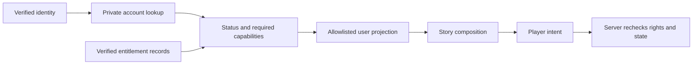

# UserContext: account ownership and projection

Status: target design. Decisions S04, S06, S09. Read [keys](keys.md) for entitlements and imports. UserContext owns account-wide facts; PlayerContext owns the active run. One UID is the initial account identity; multiple personas are not assumed.

## Private account and safe projections

| Data | Owner/source | What Story code may see |
| --- | --- | --- |
| Authentication | Auth adapter/provider | Stable actor ID; credentials/tokens remain outside portable contracts |
| Display preferences/profile | User through validated profile commands | Only needed display fields |
| Account stats/level | Authoritative progression service | Allowed stats snapshot at run start; later changes do not silently alter it |
| Achievement/export facts | Validated completion/reward service | Only declared, authorized facts with provenance |
| Save references | Owned runs | Bounded safe list or active-save reference; not full saves/history |
| Entitlements | Verified subscription/payment/promotion issuer | Narrow capability projection for UI; server rechecks authority |
| Wallet, billing and private audit | Dedicated service | No raw billing records or mutable balances in a story's context |
| Creator/admin feature flags | Account access policy | Relevant UI capabilities, never self-granting rights |

The current `StoryUser` is a small projection with identity, stats, achievements and save spots. It is not the full UserContext and must not become a raw Firebase user. Current `publish`, `generate` and `copilot` feature flags are administrative capabilities, not proof of a paid subscription. Account achievement progression and generalized entitlements remain future work.

## Authorization flow

The client projection helps presentation but cannot authorize commands. Each service validates actor identity, ownership and current required permissions. Cross-user reads, claim IDs and save references are checked independently; possessing an ID is not permission.

## Global progress and key boundaries

A story can award its namespaced local key through a validated effect. An approved export can create a persistent account fact, such as completion of a canonical chapter. A creator cannot grant platform XP, premium access, another creator's achievement, currency or a subscription merely by defining a key with that name.

Account facts require an issuer, namespace, source event/run, definition version, claim identity and revocation policy. Unique claim scope prevents farming across repeated runs; ordinary request receipts alone are insufficient because they expire. Eligibility and duplicate claims are checked atomically with the grant, or through a durable idempotent outbox when a separate service is involved.

Export availability is distinct from public profile display. A fact can be private to the user and authorized story checks. Other creators receive only declared boolean/value projections through the platform, never direct access to the user's historical saves. User sharing consent and cross-creator trust/namespace authorization must be specified before broad exports launch.

## Live changes and unavailable access

Narrative completion facts are stable snapshots unless explicitly revoked for integrity reasons. Subscriptions, paid access, bans and expiring promotional rights are live permissions, checked at start/resume and protected actions according to published policy. Expiry does not delete the user's saves or rewrite completed events. Provide a recoverable access explanation and catalogue/account navigation.

Refund/revocation behavior, offline access leases and whether an already-started paid story remains playable require product decisions before billing implementation. Never silently turn a one-time entitlement snapshot into permanent paid access.

## Checks

Verify minimal projections, no credentials in portable contracts, cross-user denial, rejected forged flags, idempotent unique claims, concurrent grants, expiry/revocation and continued preservation of owned saves. Do not assume the UI hiding a control is authorization.
